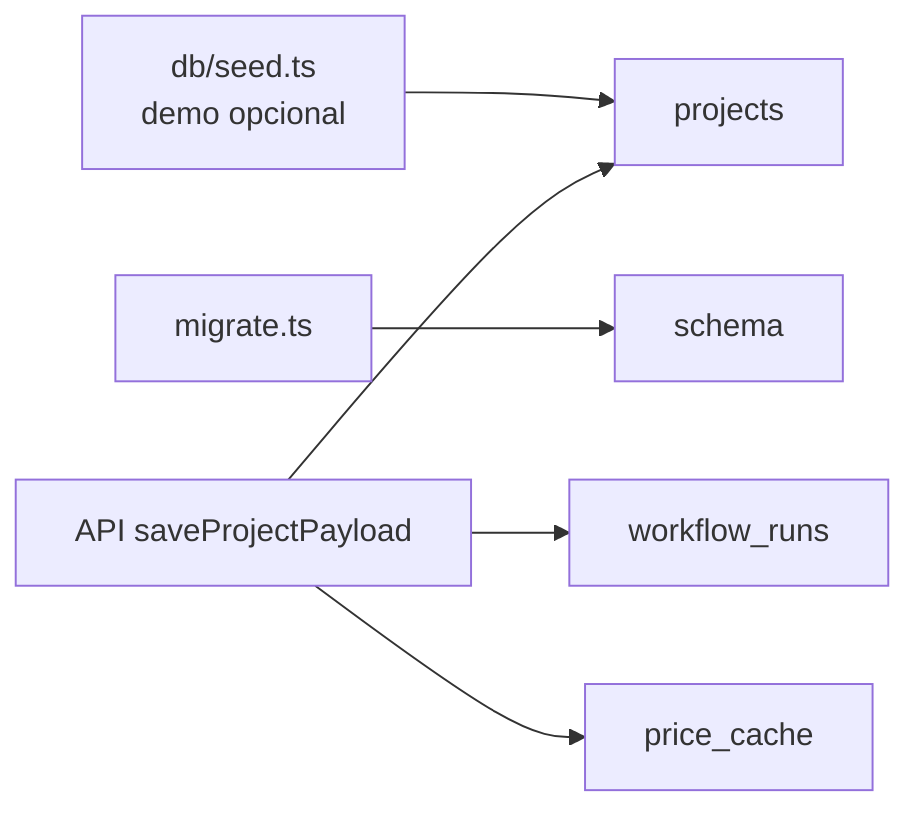

# Base de datos

**Motor:** PostgreSQL 18  
**ORM:** Drizzle (`src/server/db/schema.ts`)  
**Migraciones:** SQL versionado en `src/server/db/migrations/`, aplicadas por `migrate.ts` al arrancar el contenedor.

## Diagrama entidad-relación (lógico)

```mermaid
erDiagram
  workspaces ||--o{ users : has
  workspaces ||--o{ projects : has
  workspaces ||--o{ regional_stores : has
  users ||--o{ sessions : has
  projects ||--o{ workflow_runs : has
  projects ||--o{ project_references : has
  projects ||--o| project_reference_analyses : has

  workspaces {
    uuid id PK
    text name
    timestamptz created_at
  }

  users {
    uuid id PK
    uuid workspace_id FK
    text email UK
    text password_hash
    boolean is_demo
  }

  sessions {
    text id PK
    uuid user_id FK
    timestamptz expires_at
  }

  projects {
    uuid id PK
    uuid workspace_id FK
    text name
    text address
    text region
    jsonb payload
    real usd_crc_rate
    timestamptz updated_at
  }

  project_references {
    uuid id PK
    uuid project_id FK
    text title
    text media_type
    bytea content
    text asset_name
  }

  project_reference_analyses {
    uuid project_id PK_FK
    jsonb result
  }

  regional_stores {
    text id PK
    uuid workspace_id PK_FK
    text name
    text website_url
    jsonb last_probe
  }

  workflow_runs {
    uuid id PK
    uuid project_id FK
    text thread_id
    text stage
    text pending_gate
    jsonb state
  }

  price_cache {
    uuid id PK
    uuid workspace_id
    text url
    integer price_crc
    jsonb payload
  }
```

## Tablas

### `workspaces`, `users`, `sessions`

Autenticación y límite de datos por espacio de trabajo. Demo: usuario con `is_demo` y seed opcional (`APP_SEED_DEMO`).

### `projects`

Cabecera del proyecto + **documento JSON** en `payload`.

| Columna | Uso |
| --- | --- |
| `region` | `guanacaste` \| `limon` \| `san-jose` \| `alajuela` |
| `payload` | Serialización de `FurnishingProject` sin duplicar `id`/`workspaceId` de la fila |
| `usd_crc_rate` | Tasa venta (o fallback) usada en UI y Excel |

Estructura típica de `payload` (TypeScript `FurnishingProject`):

```json
{
  "zones": [{ "id": "zona-a", "slug": "sala", "labelEs": "Sala", "areaM2": 12.5 }],
  "items": [{
    "id": "item-001",
    "zoneId": "zona-a",
    "name": "Sofá dos plazas",
    "category": "mobiliario",
    "qty": 1,
    "quotes": [{ "tier": "balanced", "priceCrc": 150000, "storeName": "..." }],
    "unquotedReason": null
  }],
  "budgetTiers": ["economy", "balanced", "premium"]
}
```

Cada ítem puede tener **varias** `quotes` (por tier y fuente). La UI suele mostrar el tier primario (`budgetProfiles.primaryBudgetTier`).

### `project_references` / `project_reference_analyses`

Imágenes subidas por proyecto (`bytea` o `asset_name` para assets empaquetados) y resultado JSON de análisis (sugerencias de ítems).

Migración: `0002_project_references.sql`.

### `regional_stores`

Tiendas por workspace (MisterPrecios, AhorraYa, etc.). PK compuesta `(id, workspace_id)`. `last_probe` guarda resultado del probe HTTP.

Migración: `0003_store_websites.sql` añade/ajusta sitios.

### `workflow_runs`

Historial y estado de ejecuciones del grafo:

| Campo | Contenido |
| --- | --- |
| `thread_id` | Id estable del hilo LangGraph |
| `stage` | Último `AgentStage` |
| `pending_gate` | `zone_layout` \| `final_budget` \| null |
| `state` | `ReviewSnapshot`: notas, actividad, `approvedGates`, eventos |

### `price_cache`

Tabla **UNLOGGED** para caché efímero de ofertas scrapeadas (no crítica para backup). Clave lógica por `workspace_id` + `url`.

### `langgraph_checkpoints` / `langgraph_writes`

Esquema compatible con LangGraph Postgres checkpointer (ver migración `0001_init.sql`). **Aún no** cableado en runtime; previsto para persistir hilos.

## Índices y extensiones

- `pgcrypto`, `pg_trgm` (búsqueda futura).
- `users_email_uidx` único global en email.
- `project_references_project_created_idx` para listar referencias por proyecto.

## Ciclo de vida de datos



## Consultas habituales (conceptual)

| Operación | Tablas |
| --- | --- |
| Login | `users`, `sessions` |
| Listar proyectos | `projects` WHERE `workspace_id` = sesión |
| Cotizar ítem | READ/WRITE `projects.payload` |
| Historial agentes | `workflow_runs` ORDER BY `updated_at` |
| FX global | UPDATE `projects.usd_crc_rate` masivo |

## Backup y retención

- Persistente: volumen Docker `natarundi_pg_data` (Dokploy).
- Descartable: `price_cache` (UNLOGGED), sesiones expiradas (sin job de limpieza automática aún — expiran en validación).