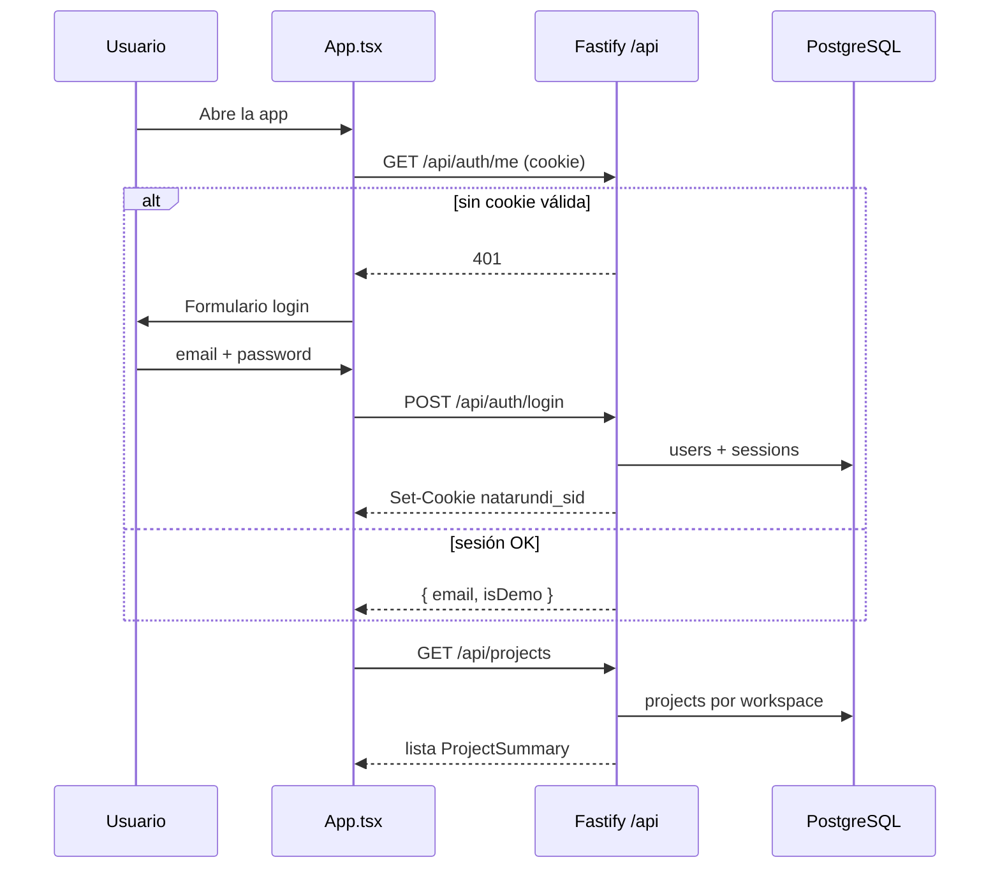
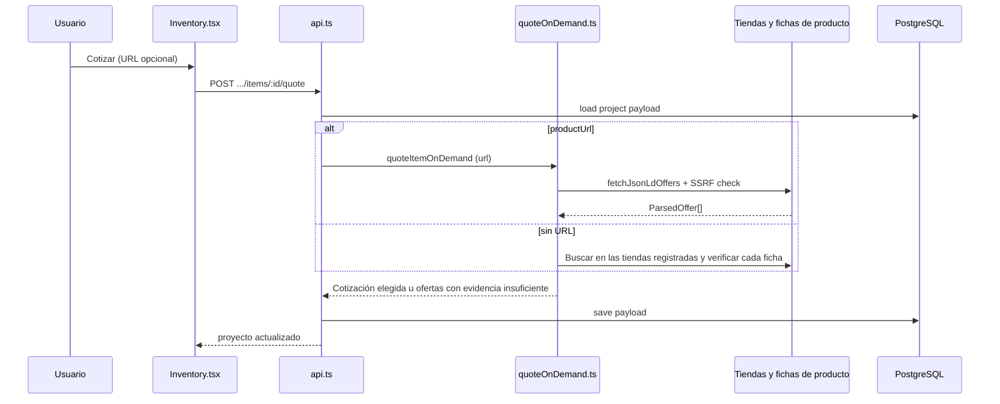
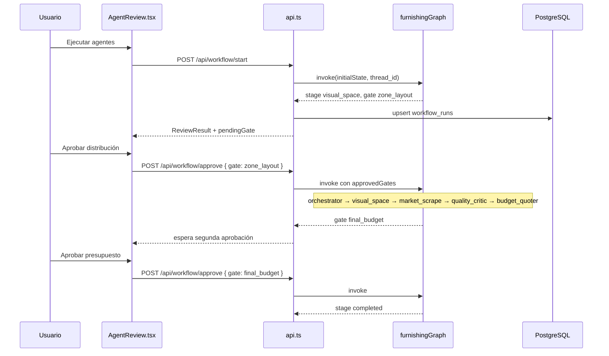
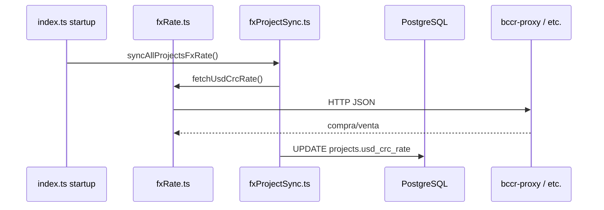
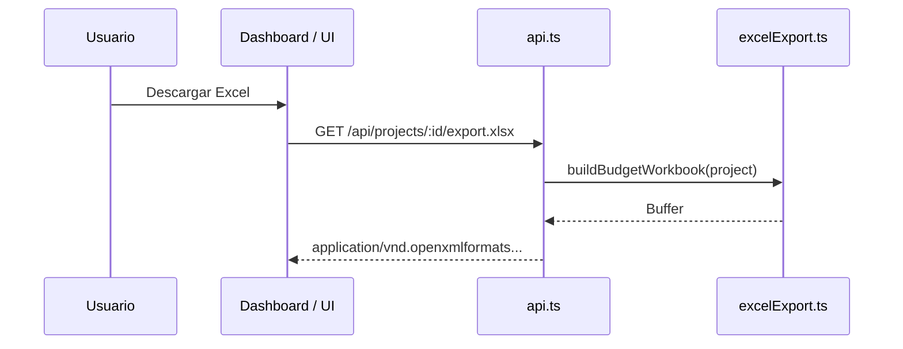
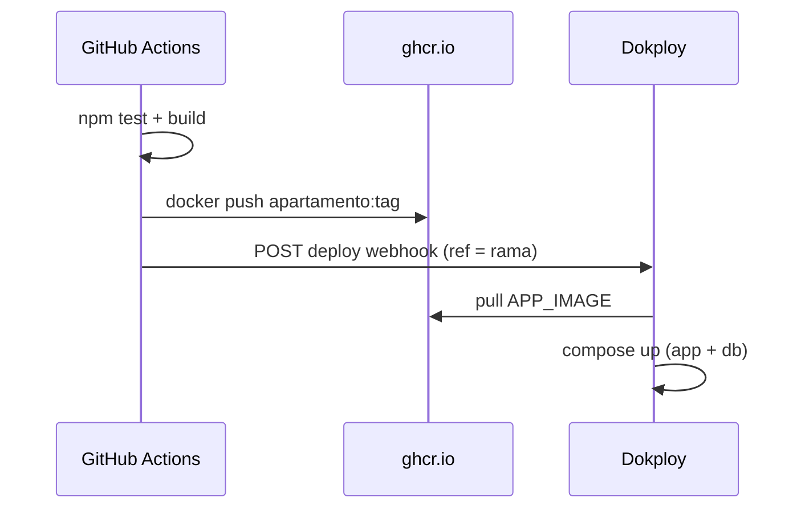

# Diagramas de secuencia

Convenciones: el cliente usa `fetch` vía `api()` / `post()` en `ui.tsx`. Errores 401 redirigen a login.

## Sesión y acceso a proyecto

## Cotizar un ítem (on demand)

Cotización masiva: `POST /api/projects/:id/quote-pending` recorre ítems sin precio con concurrencia `QUOTE_CONCURRENCY` y puede emitir eventos de progreso (SSE) vía `respondWithProgress`.

## Pipeline de agentes (HITL)

Grafo compilado en `furnishingGraph.ts`: nodos `orchestrator`, `visual_space`, `market_scrape`, `quality_critic`, `budget_quoter`. Los gates pausan con `gate` en estado hasta que `approvedGates` incluye el id.

## Tipo de cambio USD/CRC

`GET /api/fx` devuelve caché; `POST /api/fx/refresh` fuerza recarga (`FX_PROVIDER`, `FX_CACHE_TTL_MINUTES`).

## Exportación Excel

## CI/CD (referencia)

Detalle en [deployment-dokploy.md](./deployment-dokploy.md).