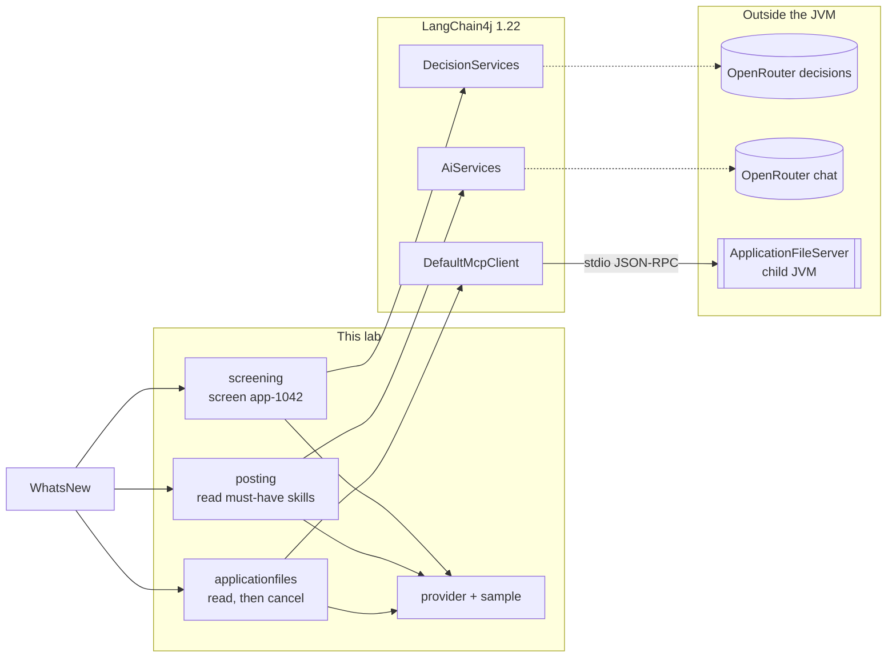
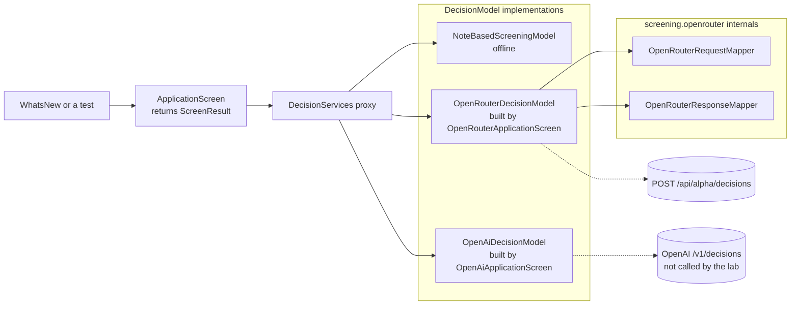
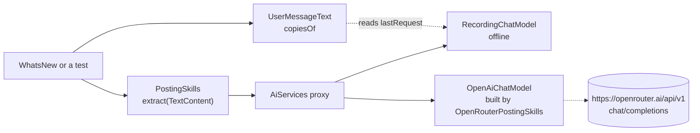
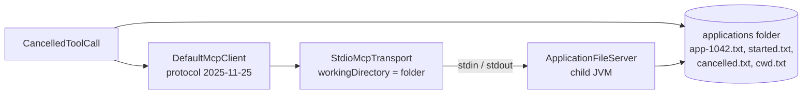
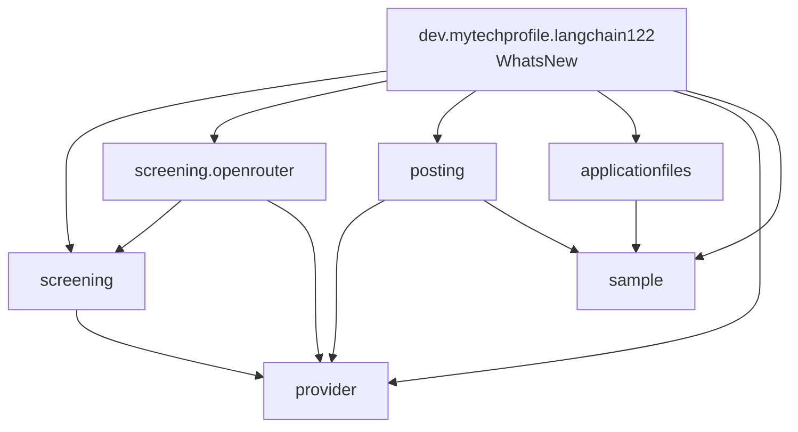
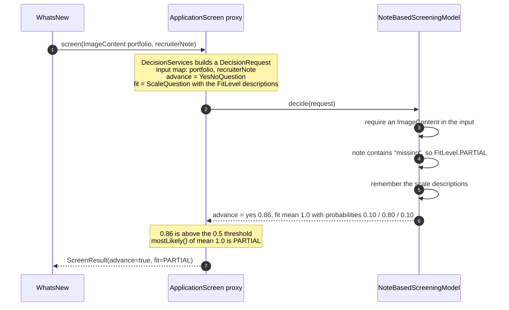
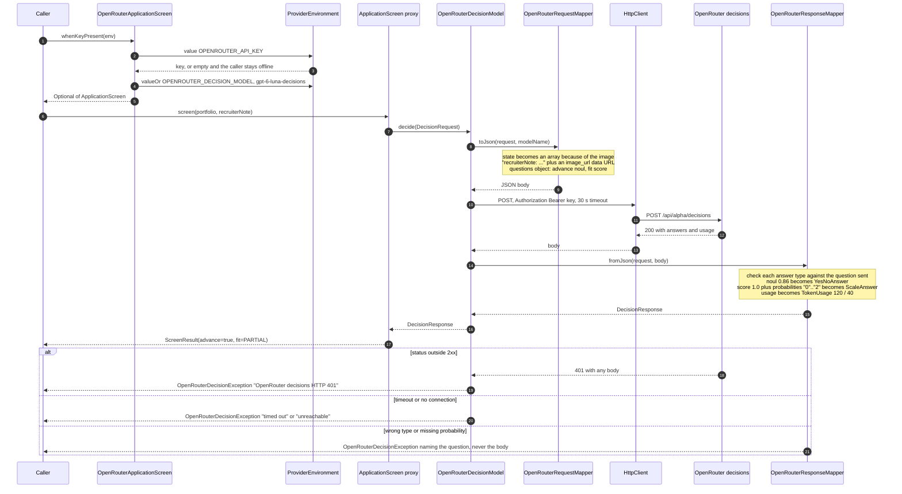
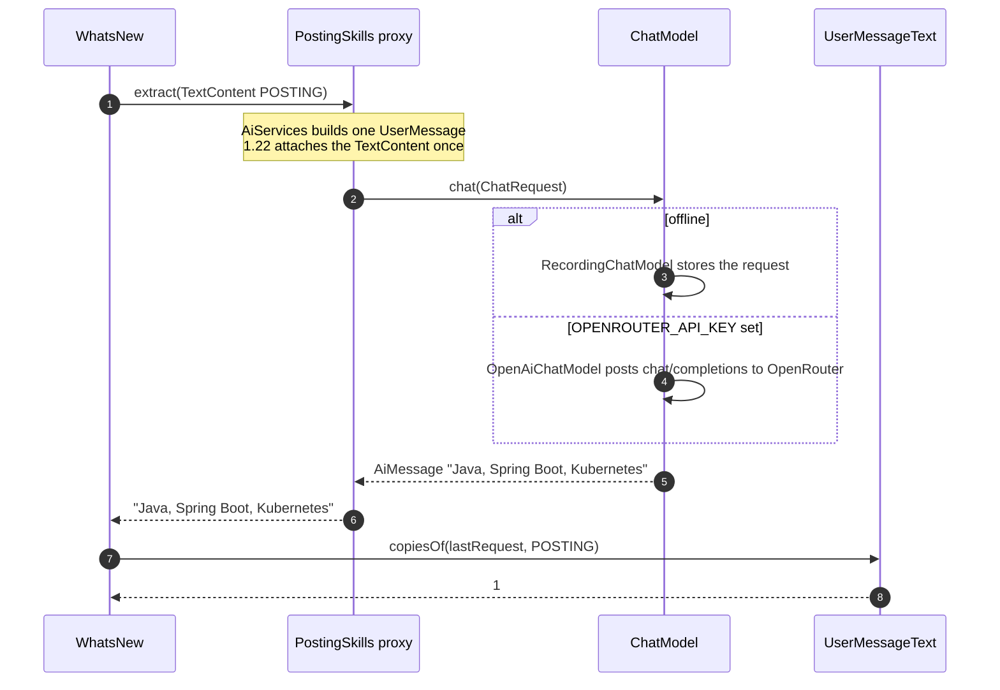
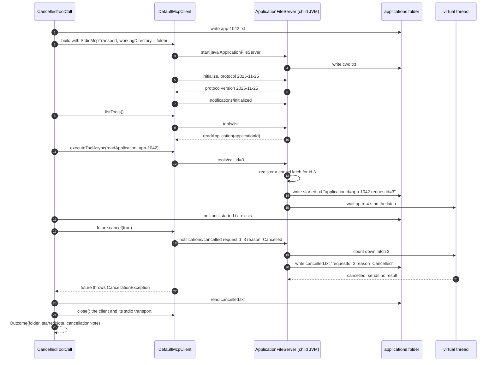
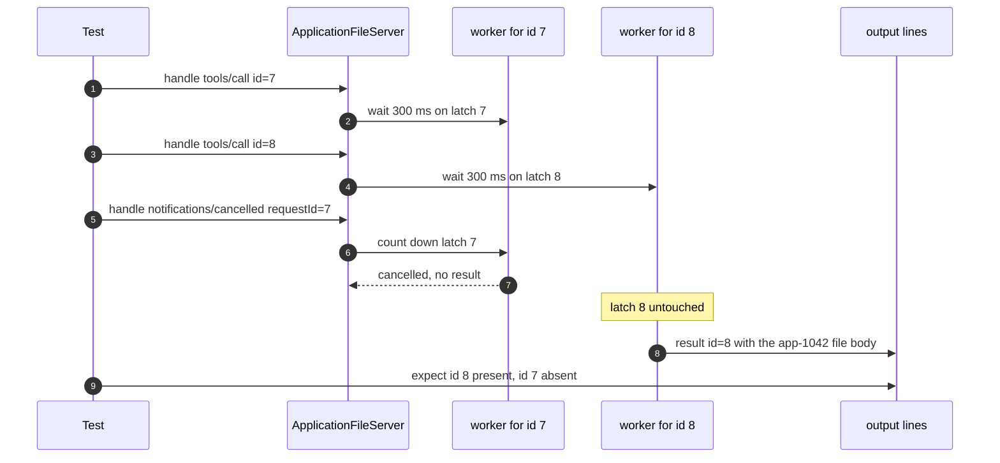

# Architecture

Every diagram follows application `app-1042`: a backend role whose must-haves are Java, Spring Boot, and Kubernetes. The recruiter note says Kubernetes is missing. The portfolio is a one-pixel PNG standing in for a service diagram. It is a work sample, never a photo of the candidate.

The diagrams are Mermaid, so GitHub and most Markdown previews render them. PNG copies for slides, wikis, or viewers without Mermaid are in [diagrams/](diagrams/). See [PNG exports](#png-exports).

## Components

Three ATS jobs, each in its own package. `WhatsNew` is the only class that uses all three. Dashed arrows only happen with an API key, so `./gradlew test` and `./gradlew run` never leave the machine.



### Inside screening

`ApplicationScreen` is the interface the caller depends on. `DecisionServices` turns it into a proxy over any `DecisionModel`, so the three models can be swapped without touching the caller.



### Inside posting



### Inside applicationfiles



## Package dependencies



`screening`, `posting`, and `applicationfiles` never import each other. Tests import `sample` freely.

## Screen offline

`./gradlew run` and `ApplicationScreenMapsPortfolioAndFitDescriptionsTest` follow this path. No HTTP call is made.



## Screen on OpenRouter

Used when `OPENROUTER_API_KEY` is set and you call `OpenRouterApplicationScreen.whenKeyPresent`. The tests run the same path against a local `HttpServer` on `127.0.0.1`.



The exception text never includes the key, the note, the image, or the response body.

## Read the posting skills

`PostingTextIsSentOnceTest` and `./gradlew run` use `RecordingChatModel`. With a key, `OpenRouterPostingSkills` swaps in `OpenAiChatModel` pointed at `https://openrouter.ai/api/v1`.



## Cancel an application file read

`CancelledStdioToolSendsNotificationTest` and `./gradlew run` follow this path. The child server is a second JVM started by `StdioMcpTransport`.



The client assigns the request id. It has been `3` in local runs, after `initialize` and `tools/list`, and the test accepts any number. The notification tells the server the client stopped waiting. It does not prove the server stopped work. A tool an AI Service has already started is a separate call, and `@CompensateFor` does not cover MCP tools.

## Cancel one read, finish another

`CancellingOneReadLetsOtherReadsFinishTest` drives `ApplicationFileServer.handle` directly, without a child process. Each read has its own latch, so cancelling request 7 cannot suppress request 8.



## Where to change what

| Change | Start in |
| --- | --- |
| A new screening question | `ScreenResult` record components with `@Decide` |
| How a question type maps to OpenRouter | `OpenRouterRequestMapper.question` and `OpenRouterResponseMapper.answer` |
| HTTP timeouts, headers, or failure messages | `OpenRouterDecisionModel` |
| A new environment variable | The factory that needs it, read through `ProviderEnvironment` |
| MCP tool schema or cancellation behavior | `ApplicationFileServer` |
| The `app-1042` story text | `AtsSample` |

## PNG exports

Each Mermaid block above has a PNG copy, in the same order:

| Section | PNG |
| --- | --- |
| Components | [components-overview.png](diagrams/components-overview.png) |
| Inside screening | [components-screening.png](diagrams/components-screening.png) |
| Inside posting | [components-posting.png](diagrams/components-posting.png) |
| Inside applicationfiles | [components-applicationfiles.png](diagrams/components-applicationfiles.png) |
| Package dependencies | [package-dependencies.png](diagrams/package-dependencies.png) |
| Screen offline | [sequence-screen-offline.png](diagrams/sequence-screen-offline.png) |
| Screen on OpenRouter | [sequence-screen-openrouter.png](diagrams/sequence-screen-openrouter.png) |
| Read the posting skills | [sequence-read-posting-skills.png](diagrams/sequence-read-posting-skills.png) |
| Cancel an application file read | [sequence-cancel-application-read.png](diagrams/sequence-cancel-application-read.png) |
| Cancel one read, finish another | [sequence-cancel-one-read-finish-another.png](diagrams/sequence-cancel-one-read-finish-another.png) |

The Mermaid source in this file is the source of truth. After editing a diagram, regenerate the PNGs from the lab root. This needs Node; `npx` downloads `@mermaid-js/mermaid-cli` on first use.

```bash
work=$(mktemp -d)
awk -v dir="$work" '/^```mermaid/{f=1;n++;out=sprintf("%s/d%02d.mmd",dir,n);next} /^```/{f=0} f{print > out}' docs/architecture.md
names=(components-overview components-screening components-posting components-applicationfiles package-dependencies sequence-screen-offline sequence-screen-openrouter sequence-read-posting-skills sequence-cancel-application-read sequence-cancel-one-read-finish-another)
i=1
for name in "${names[@]}"; do
  npx -y -p @mermaid-js/mermaid-cli mmdc -i "$(printf '%s/d%02d.mmd' "$work" $i)" -o "docs/diagrams/$name.png" -b white -s 2 -q
  i=$((i+1))
done
```

Adding or reordering a Mermaid block shifts the numbering, so update `names` to match.
