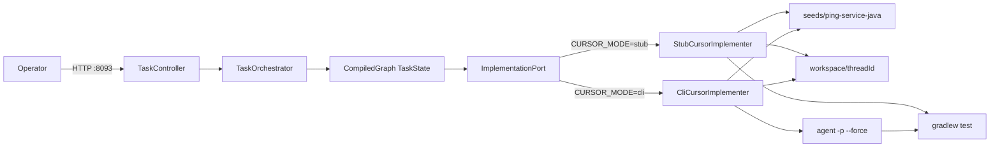
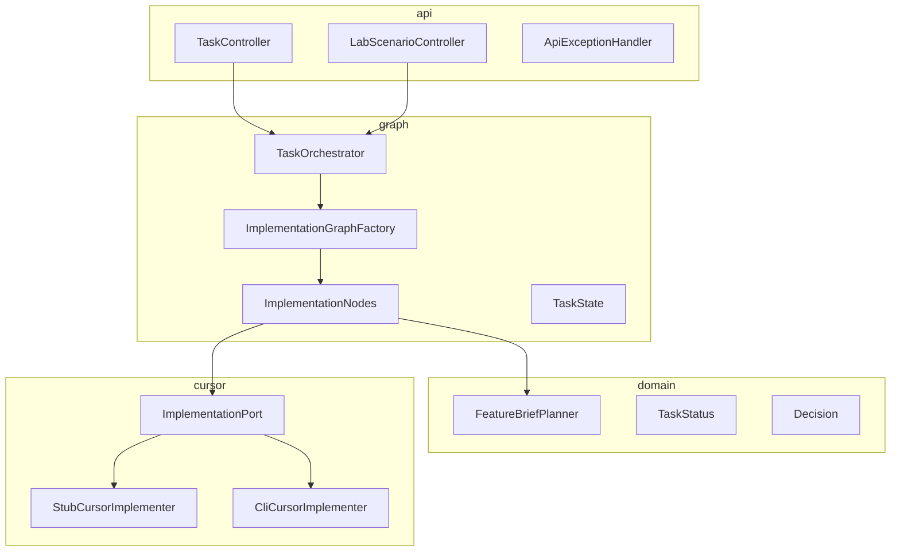
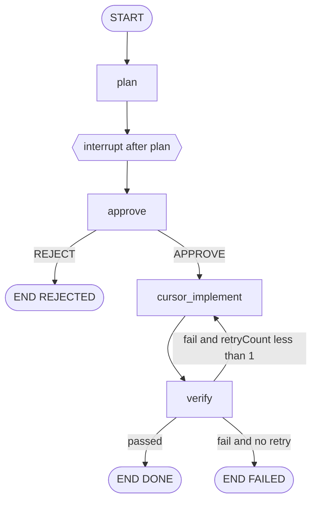
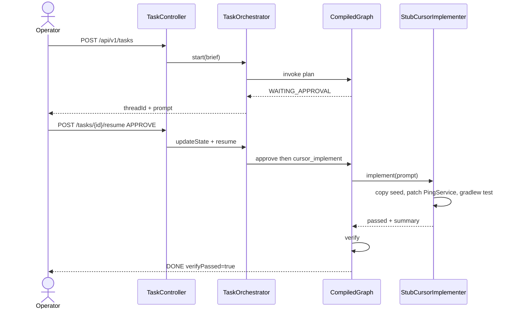

# LangGraph4j + Cursor — High-Level Architecture

**Status:** As-built  
**Audience:** Engineers extending this POC  
**Related:** [README.md](../README.md), [api.md](api.md), [use-cases.md](use-cases.md)

## 1. Purpose and scope

This lab shows **LangGraph4j as the orchestrator** and **Cursor as one implementer node**. The graph owns topology, in-memory checkpoints, human interrupt, resume, and a single verify retry. Cursor does not plan, approve, or route.

The scenario is a Feature Brief for the `seeds/ping-service-java` playground: `PingService.status()` must return `ok`. The default implementer is a local stub so `./gradlew check` never calls Cursor.

### Goals

- Teach `StateGraph`, `MemorySaver`, `interruptAfter("plan")`, and resume.
- Keep Cursor behind `ImplementationPort` so stub and local CLI swap by config.
- Pause after `plan` so a human can approve, reject, or override the prompt.

### Non-goals

- Production auth, Postgres checkpoints, A2A, MCP.
- Cursor in every node (PO / Tech Lead / Review stay out of this graph).
- A second-engine bake-off.
- Cloud Agents / GitHub `CURSOR_REPO_URL` (unused).

## 2. System context

The operator talks to Spring HTTP. The graph runs in-process. The implementer either patches a copied seed or runs the local Cursor `agent` CLI on that copy.

Checkpoints live in a process-local `MemorySaver`. Restarting the JVM drops threads. CLI mode needs `CURSOR_API_KEY` and `agent` on `PATH`. Stub mode needs neither. `CURSOR_REPO_URL` is unused.

## 3. Architecture principles

| Principle | How this repo applies it |
| --- | --- |
| Graph owns control flow | `ImplementationGraphFactory` compiles plan → approve → implement → verify |
| Cursor is a worker | Only the `cursor_implement` node calls `ImplementationPort` |
| Interrupt before side effects | `CompileConfig.interruptAfter("plan")` so implement never runs unapproved |
| Verify is deterministic | Both stub and CLI run `./gradlew test` after the workspace edit |
| Tests stay offline | `./gradlew check` uses the stub. Do not call Cursor from unit tests |
| Secrets stay in env | `CURSOR_API_KEY` is never logged |

## 4. Component view

| Component | Responsibility | Technology |
| --- | --- | --- |
| `TaskController` | Start, inspect, resume, Mermaid, engine meta | Spring Web MVC, port **8093** |
| `LabScenarioController` | List and run catalog recipes | `GET/POST /api/v1/scenarios` |
| `TaskOrchestrator` | Thread ids, `GraphInput.args` / `resume`, `updateState` | LangGraph4j `CompiledGraph` |
| `ImplementationGraphFactory` | Node/edge wiring and `interruptAfter("plan")` | LangGraph4j `StateGraph` 1.8.26 |
| `ImplementationNodes` | Plan, approve, implement, verify actions | Pure Java `NodeAction` |
| `TaskState` | Channels for prompt, decision, Cursor ids, verify, retry | `AgentState` + `Channels` |
| `FeatureBriefPlanner` | Deterministic prompt from the brief (no LLM) | Domain helper |
| `ImplementationPort` | Swap stub vs local CLI | Interface |
| `StubCursorImplementer` | Copy seed, patch `PingService`, run Gradle | Local filesystem |
| `CliCursorImplementer` | Copy seed, `agent -p --force`, run Gradle | Local Cursor CLI |
| `MemorySaver` | In-process checkpoints | LangGraph4j |
| `seeds/ping-service-java` | Failing acceptance test the implementer must fix | Java seed |

## 5. Data flows

`POST /api/v1/tasks` runs `plan` and stops. `POST .../resume` writes `decision` (and optional `promptOverride`) then continues.

Retry routing reads the **new** state after verify increments `retryCount`. The edge uses `status == IMPLEMENTING` for retry, `verifyPassed` for done, otherwise failed. Cap is `maxRetries = 1`.

### Happy path (CLI)

Same interrupt, then `CliCursorImplementer` copies the seed, runs `agent`, and Gradle decides pass/fail.

### Happy path (stub)

Reject never calls the port. Status is `REJECTED`.

## 6. Integration points

| Integration | When | Contract |
| --- | --- | --- |
| HTTP API | Always | [api.md](api.md) — RFC 9457 errors |
| Stub workspace | `CURSOR_MODE=stub` (default for `check`) | Copy seed, patch `PingService`, run `gradlew test` |
| Local Cursor CLI | `CURSOR_MODE=cli` | Copy seed, `agent -p --force --workspace <copy>`, then `gradlew test`. Needs `CURSOR_API_KEY` |
| Actuator | Always | `/actuator/health` |

`CURSOR_REPO_URL` is unused. Cloud Agents remain in the tree (`CURSOR_MODE=cloud`) but are not the POC path.

## 7. State model

`TaskState` channels are the source of truth for one thread.

| Channel | Writer | Meaning |
| --- | --- | --- |
| `threadId` | orchestrator start | UUID |
| `brief` | start | Operator Feature Brief |
| `prompt` | `plan`, optional resume override | Text the implementer receives |
| `decision` | resume | `APPROVE` or `REJECT` |
| `status` | nodes | `TaskStatus` enum |
| `cursorAgentId` / `cursorRunId` / `cursorUrl` | implement | Empty on stub and CLI |
| `implementationSummary` | implement | Human-readable outcome |
| `verifyPassed` / `verifyOutput` | implement | Gate result |
| `retryCount` / `maxRetries` | verify / schema default | One retry max |
| `implementerMode` | implement | `STUB` or `CLI` |
| `steps` | all nodes | Append-only timeline |

## 8. Non-functional design

| Concern | Choice |
| --- | --- |
| Persistence | `MemorySaver` only. No Postgres. |
| Auth | None. Local POC. |
| Secrets | Env / `.env`. Never log the API key. |
| Timeouts | Gradle verify: 3 minutes. CLI implement: `CURSOR_IMPLEMENT_TIMEOUT` (default 10m). |
| Scale | One JVM, in-memory thread map. Not multi-instance. |
| Errors | RFC 9457 `ProblemDetail`. Unknown `threadId` is 404. |

## 9. Deployment view

| Path | Use |
| --- | --- |
| `jenv shell 26 && ./gradlew bootRun` | Host demo, UI at `http://localhost:8093` |
| `docker compose up --build` | Same app; `CURSOR_MODE` defaults to `stub` |
| `./gradlew check` | Compile, unit tests, no Cursor |

Java **26**, Spring Boot **4.1.0**, LangGraph4j **1.8.26**, Gradle Groovy. Package root: `dev.mytechprofile.langgraph4j`.

## 10. Risks and mitigations

| Risk | Mitigation |
| --- | --- |
| CLI says done but tests fail | Gradle `test` after `agent` is the gate |
| Process restart loses threads | Acceptable for the POC; do not add a store unless asked |
| Extra constructor on `@ConfigurationProperties` records | Keep a single canonical constructor (Spring constructor binding) |
| Retry edge reads stale `canRetry()` | Route on post-verify `status == IMPLEMENTING` |

## 11. Open decisions

| Question | Current default | Owner |
| --- | --- | --- |
| Persist checkpoints? | No | Lab owner |

## Revision history

| Date | Summary |
| --- | --- |
| 2026-09-06 | Recreated as-built HLA; live path is local Cursor CLI, not Cloud Agents |
