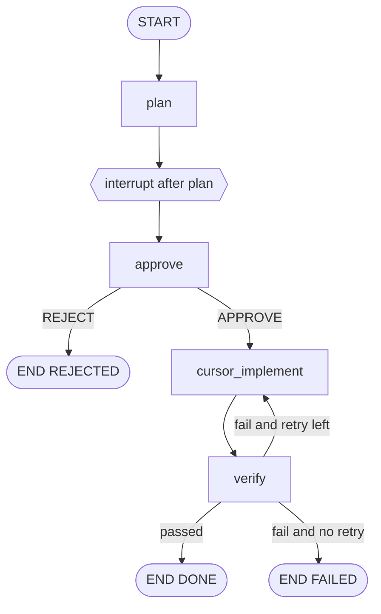

# Lab use cases

**Status:** As-built  
**Audience:** Reviewers walking the LangGraph4j + Cursor lab  
**Related:** [architecture.md](architecture.md), [api.md](api.md), catalog in `LabScenarioCatalog`

This index lists every recipe the dashboard can run, plus the verify-retry path that only the graph tests exercise. Each page has a sequence diagram, the path through the compiled graph, resulting state, and how to run it.

The graph is the same for every case. The use case only changes the brief, whether resume happens, and the human decision.

## Shared graph

`CompileConfig.interruptAfter("plan")` pauses after the planner writes the Cursor prompt. Resume writes `decision` (and optional `promptOverride`), then `approve` runs.



| Catalog id | UI title | Auto decision | Expected status | Page |
| --- | --- | --- | --- | --- |
| `interrupt-only` | Pause before Cursor | none | `WAITING_APPROVAL` | [01](use-cases/01-interrupt-only.md) |
| `approve-ping` | Approve happy path | `APPROVE` | `DONE` | [02](use-cases/02-approve-ping.md) |
| `reject-ping` | Reject after plan | `REJECT` | `REJECTED` | [03](use-cases/03-reject-ping.md) |
| `override-prompt` | Approve with prompt override | `APPROVE` | `DONE` | [04](use-cases/04-override-prompt.md) |
| `default-brief` | Empty brief fallback | none | `WAITING_APPROVAL` | [05](use-cases/05-default-brief.md) |
| — | Verify fails, retry once | `APPROVE` (test port) | `FAILED` | [06](use-cases/06-verify-retry.md) |

`CURSOR_MODE` is server config (`STUB` by default). It is not a per-request field. `./gradlew check` stays on the stub.

## How to run any catalog recipe

UI: open [http://localhost:8093](http://localhost:8093), select the card, click **Run scenario**.

HTTP:

```bash
curl -s -X POST http://localhost:8093/api/v1/scenarios/<id>/run
```

Manual path (same graph, no catalog): `POST /api/v1/tasks` then `POST /api/v1/tasks/{threadId}/resume`.

## Revision history

| Date | Summary |
| --- | --- |
| 2026-09-06 | Documented the five UI recipes and the verify-retry path |
