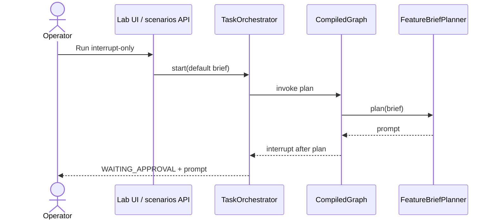
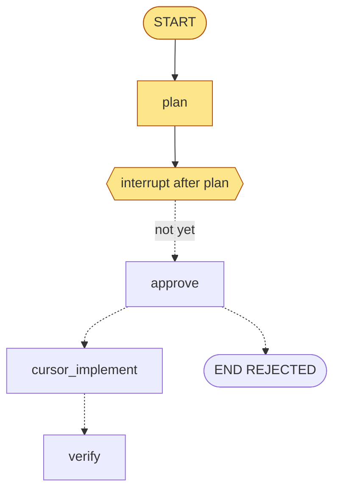

# UC-1 Pause before Cursor

**Status:** As-built  
**Catalog id:** `interrupt-only`  
**Expected status:** `WAITING_APPROVAL`  
**Duration:** instant (no implementer)

The operator starts a Feature Brief and stops after `plan`. LangGraph4j keeps the checkpoint. Cursor is not called until a later approve.

## Intent

Prove human-in-the-loop: the graph can plan a prompt and wait. The implementer node must not run on start.

## Actors and trigger

| Actor | Action |
| --- | --- |
| Operator | Runs the scenario from the UI or `POST /api/v1/scenarios/interrupt-only/run` |
| `FeatureBriefPlanner` | Builds the Cursor prompt from the default brief |
| `TaskOrchestrator` | Invokes the graph and returns the checkpoint |

No `autoDecision`. Resume is left to the operator.

## Preconditions

- App running (`./gradlew bootRun`), default `CURSOR_MODE=stub`
- Seed `seeds/ping-service-java` present (not copied yet)

## Flow





## Resulting state

| Field | Value |
| --- | --- |
| `status` | `WAITING_APPROVAL` |
| `brief` | Default Feature Brief (`PingService.status()` must return `ok`) |
| `prompt` | Planned text naming the seed, `src/`, and `./gradlew test` |
| `decision` | empty |
| `steps` | `plan: built Cursor prompt` |
| `implementerMode` | still schema default `STUB` (implement has not run) |
| `verifyPassed` | `false` |

Approve and Reject controls appear on the thread panel.

## How to run

```bash
curl -s -X POST http://localhost:8093/api/v1/scenarios/interrupt-only/run
```

Or UI card **1. Pause before Cursor**.

## Acceptance criteria

- Response status is `WAITING_APPROVAL`
- `prompt` mentions `PingService.status()` and `./gradlew test`
- `steps` has only the plan entry
- No `implement:` step
- A later `POST .../resume` with `APPROVE` or `REJECT` continues this same `threadId`
