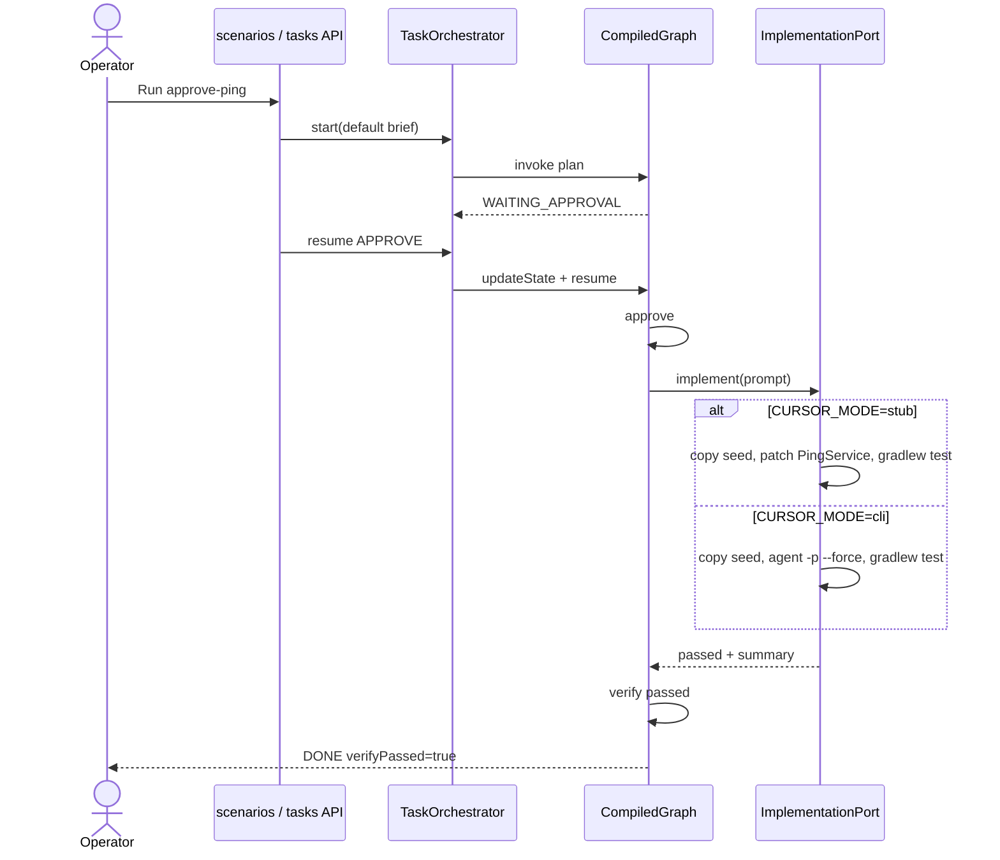
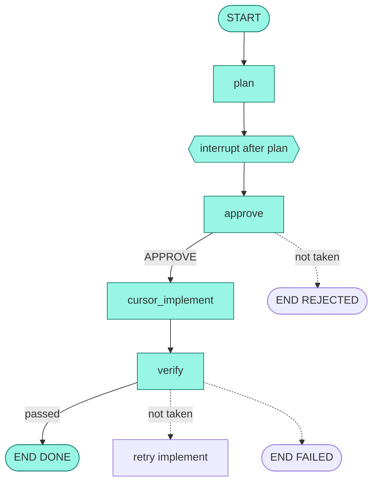

# UC-2 Approve happy path

**Status:** As-built  
**Catalog id:** `approve-ping`  
**Expected status:** `DONE`  
**Duration:** a few seconds in stub; minutes in CLI

The operator approves the planned prompt. The implementer edits a copy of the ping-service seed. `./gradlew test` is the gate.

## Intent

Walk the full success path: plan → interrupt → approve → implement → verify pass → `DONE`.

## Actors and trigger

| Actor | Action |
| --- | --- |
| Operator | Runs `approve-ping` (catalog auto-`APPROVE`) or approves a waiting thread |
| `approve` node | Sets status `IMPLEMENTING` |
| `ImplementationPort` | Stub patches `PingService`, or CLI runs `agent -p --force` |
| `verify` node | Ends `DONE` when `verifyPassed` is true |

## Preconditions

- Stub: no API key. CLI: `CURSOR_MODE=cli`, `CURSOR_API_KEY`, `agent` on `PATH`
- Seed exists; workspace is writable under `workspace/<threadId>/`

## Flow





## Resulting state

| Field | Value |
| --- | --- |
| `status` | `DONE` |
| `decision` | `APPROVE` |
| `verifyPassed` | `true` |
| `implementerMode` | `STUB` or `CLI` |
| `summary` | Stub: patched `PingService` and Gradle passed |
| `steps` | plan, approve, `implement: …`, `verify: passed` |
| `retryCount` | `0` |

Workspace: `workspace/<threadId>/ping-service-java` (copy of the seed).

## How to run

```bash
curl -s -X POST http://localhost:8093/api/v1/scenarios/approve-ping/run
```

Or UI card **2. Approve happy path**.

## Acceptance criteria

- Status is `DONE` and `verifyPassed` is `true`
- Steps include approve, implement, and `verify: passed`
- Stub does not call Cursor
- CLI copies the seed, runs `agent`, then Gradle; a failed Gradle run is UC-6, not this success path
