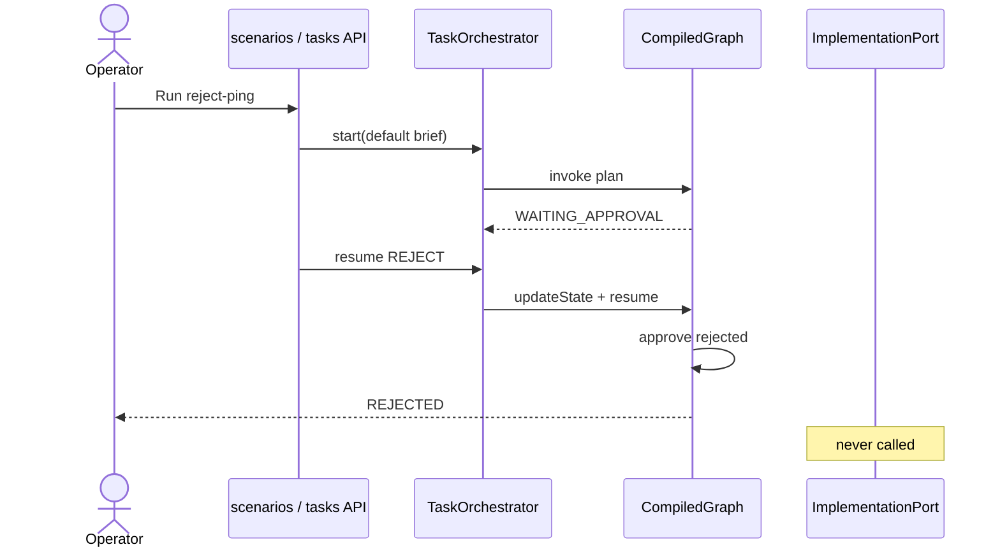
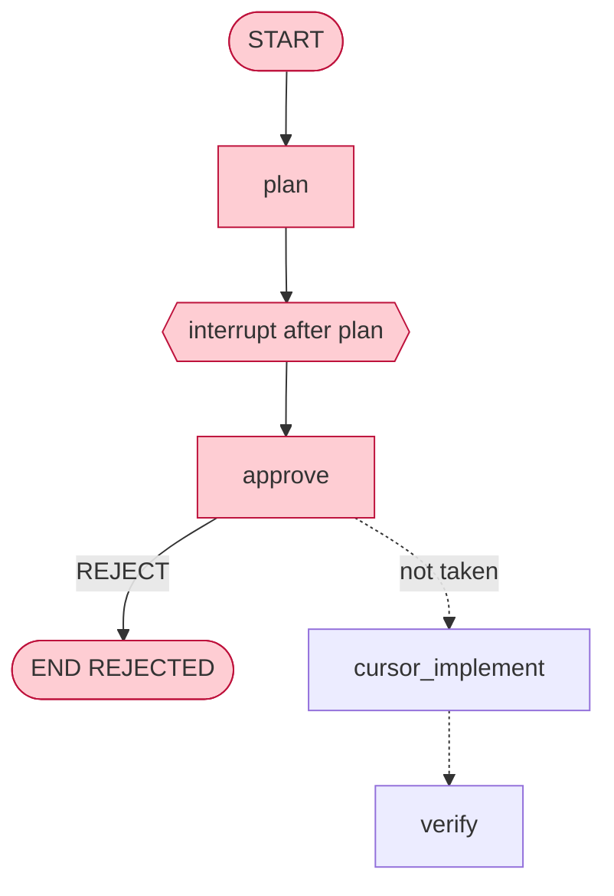

# UC-3 Reject after plan

**Status:** As-built  
**Catalog id:** `reject-ping`  
**Expected status:** `REJECTED`  
**Duration:** instant

The operator rejects the planned prompt. The graph ends. The implementer is never called.

## Intent

Show that the interrupt is a real gate: reject is a first-class outcome, not a failed implement.

## Actors and trigger

| Actor | Action |
| --- | --- |
| Operator | Runs `reject-ping` or clicks **Reject** on a waiting thread |
| `approve` node | Reads `decision=REJECT`, sets `REJECTED` |
| Conditional edge | Routes to `END` |

`ImplementationPort` is not invoked.

## Preconditions

- Same as UC-1. Implementer mode does not matter because implement does not run.

## Flow





## Resulting state

| Field | Value |
| --- | --- |
| `status` | `REJECTED` |
| `decision` | `REJECT` |
| `prompt` | Unchanged planned prompt |
| `steps` | plan, `approve: human rejected the prompt` |
| `verifyPassed` | `false` |
| Workspace | not created for this thread |

## How to run

```bash
curl -s -X POST http://localhost:8093/api/v1/scenarios/reject-ping/run
```

Or UI card **3. Reject after plan**.

Covered by `TaskApiTest.startThenRejectLeavesCursorUncalled` and `ImplementationGraphTest.rejectEndsWithoutCallingCursor`.

## Acceptance criteria

- Status is `REJECTED`
- Steps include the reject approve line and no `implement:` entry
- Recording / stub port call count stays `0`
- `verifyPassed` stays `false`
