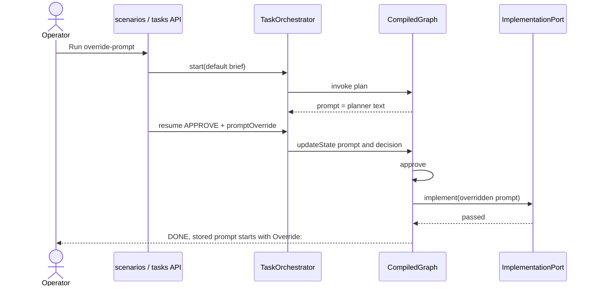
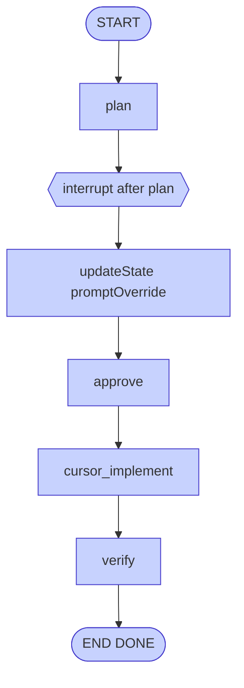

# UC-4 Approve with prompt override

**Status:** As-built  
**Catalog id:** `override-prompt`  
**Expected status:** `DONE` (stub)  
**Duration:** a few seconds in stub

The operator approves but replaces the planned prompt at the interrupt. Implement receives the override text, not the original planner output.

## Intent

Show that resume can patch checkpoint state (`prompt`) before `approve` and `cursor_implement` run.

## Actors and trigger

| Actor | Action |
| --- | --- |
| Operator / catalog | Resume with `APPROVE` and a non-blank `promptOverride` |
| `TaskOrchestrator.resume` | `updateState` writes `decision` and `prompt` |
| Implementer | Uses the stored `prompt` channel |

The planner still runs on start. Override happens only at resume.

## Preconditions

- Same as [UC-2](02-approve-ping.md)
- Override text still requires `PingService.status()` to return `ok` so the stub/CLI gate can pass

## Flow





Catalog override (trimmed) begins with `Override: PingService.status() must still return the exact string ok.`

## Resulting state

| Field | Value |
| --- | --- |
| `status` | `DONE` in stub |
| `decision` | `APPROVE` |
| `prompt` | Override text, not the original planner body |
| `brief` | Still the default Feature Brief from start |
| `verifyPassed` | `true` when Gradle passes |
| `steps` | plan, approve, implement, `verify: passed` |

Updating the summary later must not change how the brief was planned; only `prompt` is replaced.

## How to run

```bash
curl -s -X POST http://localhost:8093/api/v1/scenarios/override-prompt/run
```

Manual:

```bash
curl -s -X POST http://localhost:8093/api/v1/tasks/$THREAD/resume \
  -H 'Content-Type: application/json' \
  -d '{"decision":"APPROVE","promptOverride":"Override: PingService.status() must still return the exact string ok."}'
```

Or UI card **4. Approve with prompt override**. The thread form also has an optional prompt-override field.

## Acceptance criteria

- Stored `prompt` contains the override wording (`Override:`)
- `brief` is still the original start brief
- Stub path ends `DONE` with `verifyPassed=true`
- Implement is called once (`retryCount` is `0` on success)
