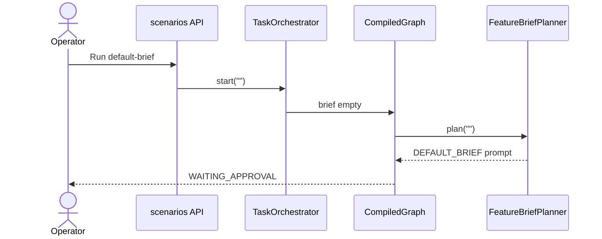
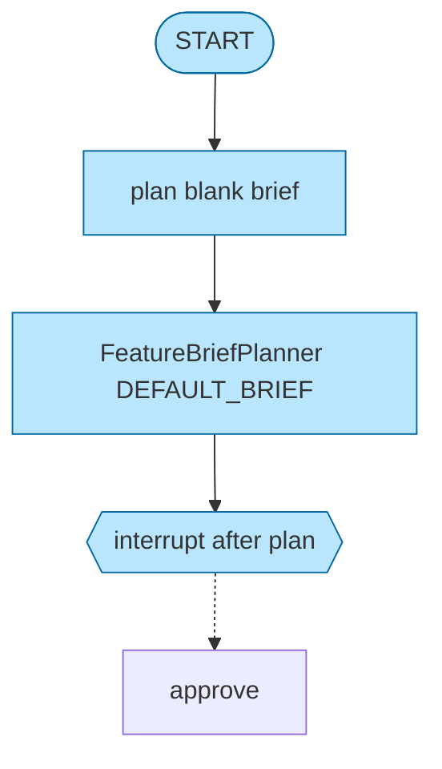

# UC-5 Empty brief fallback

**Status:** As-built  
**Catalog id:** `default-brief`  
**Expected status:** `WAITING_APPROVAL`  
**Duration:** instant

The operator starts with a blank brief. `FeatureBriefPlanner` substitutes `DEFAULT_BRIEF`. The graph still interrupts for a human decision.

## Intent

Show that planning is deterministic and safe when the UI or API sends an empty brief. The prompt still names the ping-service contract.

## Actors and trigger

| Actor | Action |
| --- | --- |
| Catalog | `brief` is `""`; no `autoDecision` |
| `FeatureBriefPlanner.plan` | Blank input → `DEFAULT_BRIEF` |
| Graph | Same interrupt as UC-1 |

`TaskController` also substitutes the default when `POST /api/v1/tasks` sends a blank brief. The catalog run passes the empty string through `start` so the planner, not the HTTP layer, is the source of the fallback.

## Preconditions

- App running. Implementer is not required.

## Flow





Default brief text: add a ping status of `ok` on the Java seed; `PingService.status()` must return the exact string `ok`; do not add extra features.

## Resulting state

| Field | Value |
| --- | --- |
| `status` | `WAITING_APPROVAL` |
| `brief` | empty string (catalog start) |
| `prompt` | Still requires `PingService.status()` to return `ok` |
| `decision` | empty |
| `steps` | plan only |

The operator then follows [UC-2](02-approve-ping.md) or [UC-3](03-reject-ping.md) on the same thread.

## How to run

```bash
curl -s -X POST http://localhost:8093/api/v1/scenarios/default-brief/run
```

Or UI card **5. Empty brief fallback** (the brief textarea is cleared). Equivalent manual start:

```bash
curl -s -X POST http://localhost:8093/api/v1/tasks \
  -H 'Content-Type: application/json' \
  -d '{"brief":""}'
```

## Acceptance criteria

- Status is `WAITING_APPROVAL`
- `prompt` still requires `PingService.status()` to return `ok`
- No implement step
- Approve / Reject remain available
