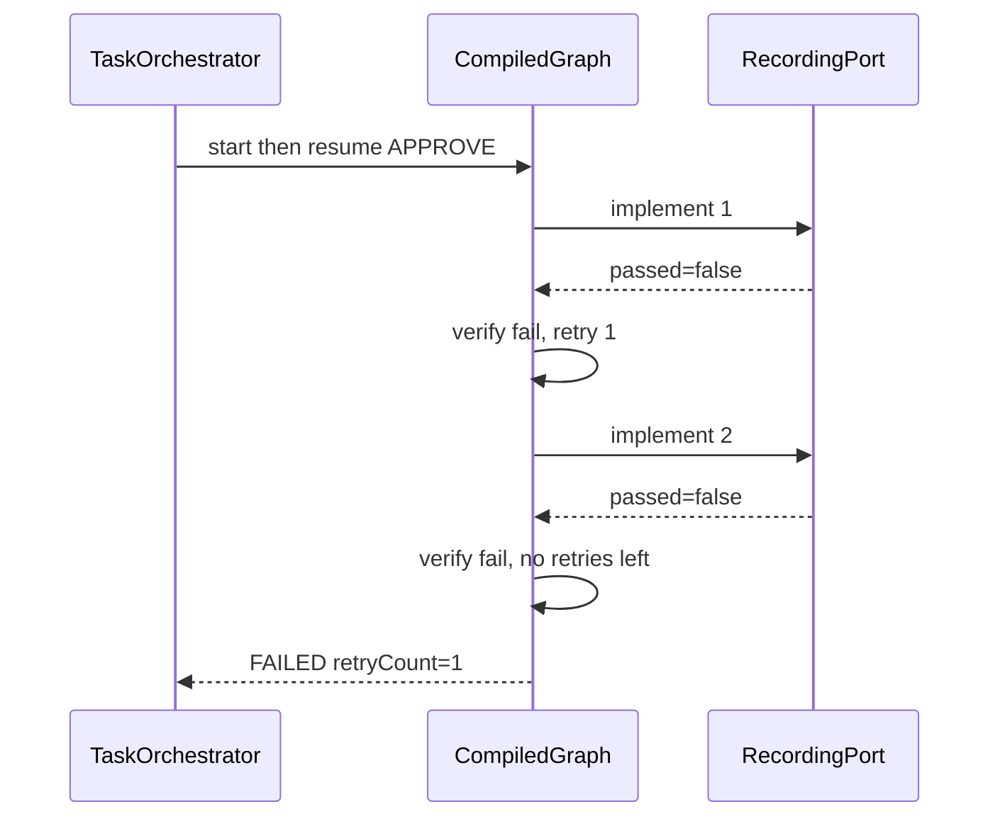
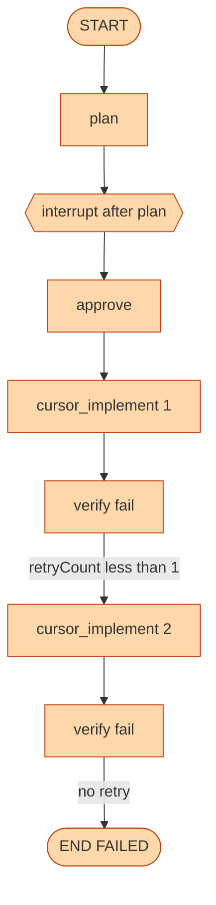

# UC-6 Verify fails, retry once

**Status:** As-built  
**Catalog id:** none (graph test only)  
**Expected status:** `FAILED` after one retry  
**Duration:** two implement calls in the unit test

The implementer returns a failing gate. Verify retries once (`maxRetries = 1`), then ends `FAILED`. This path is not a dashboard card because the stub always patches ping to pass.

## Intent

Show that LangGraph4j owns retry, not Cursor. The second implement is the same node, not a new thread.

## Actors and trigger

| Actor | Action |
| --- | --- |
| `ImplementationGraphTest` | `RecordingPort` always returns `passed=false` |
| `verify` | First fail: increment `retryCount`, status `IMPLEMENTING` |
| Conditional edge | `status == IMPLEMENTING` → back to `cursor_implement` |
| `verify` | Second fail: `retryCount` already at cap → `FAILED` |

Live CLI can reach a similar `FAILED` if `agent` edits the workspace but `./gradlew test` fails twice.

## Preconditions

- Unit test uses `RecordingPort(false)`, not the filesystem stub
- Do not add a magic brief that makes the production stub fail

## Flow





Retry routing reads state **after** verify writes the new `retryCount` and `status`. The edge must not call `canRetry()` on the pre-verify snapshot.

## Resulting state

| Field | Value |
| --- | --- |
| `status` | `FAILED` |
| `verifyPassed` | `false` |
| `retryCount` | `1` |
| `maxRetries` | `1` |
| implement calls | `2` |
| `steps` | plan, approve, implement, `verify: failed, retry 1`, implement, `verify: failed, no retries left` |

## How to run

```bash
jenv shell 26
./gradlew test --tests ImplementationGraphTest.failedVerifyRetriesOnceThenFails
```

There is no `POST /api/v1/scenarios/...` id for this path.

## Acceptance criteria

- After approve against a failing port, status is `FAILED`
- Port is called exactly twice
- `retryCount` is `1`
- `verifyPassed` is `false`
