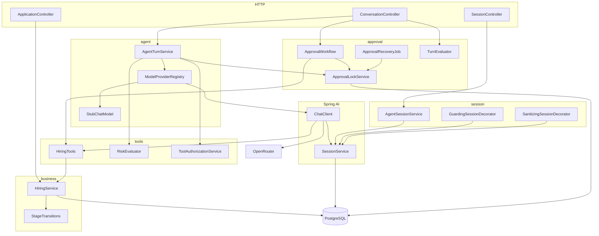

# Architecture

Spring AI 2.1 session memory and tool-call confirmation do the pause and the transcript. This application owns the hiring rules, who may ask, who may allow, and what is stored after a crash. The request and response for one turn, and where to read the log and the trace, are in [turn.md](turn.md). The timed flows are in [sequences.md](sequences.md). The first diagram there is the whole turn: open the session, read the application, pause a write, then allow it so the stage changes. What the release candidates already provide, and what this app still has to enforce, is in [findings.md](findings.md).

## Release-candidate features under test

The build is Spring Boot 4.2.0-RC1 and Spring AI 2.1.0-RC1. Stable Spring AI 2.0 does not ship these three APIs together, so the POC is pinned to the release candidates on purpose.

| Feature in the RC | What this POC does with it |
| --- | --- |
| Session memory | `SessionService` appends every turn to `AI_SESSION_EVENT`. The active window is what the model sees. A turn-count trigger compacts that window and leaves the full log readable with `view=all`. |
| Tool-call confirmation | A write tool pauses the turn. The assistant message is stored. Allow or deny resumes that same message. The model is not called again to invent a new tool call. |
| Message parts | A turn can carry an opaque part tagged with the provider that produced it. `REJECT` returns 422 when the next provider cannot read that part. `STRIP_PROVIDER_PAYLOAD` replaces it with text before the prompt is sent. |
| `SessionServiceDecorator` | `GuardingSessionDecorator` and `SanitizingSessionDecorator` wrap the auto-configured bean. The application does not declare its own `SessionService` bean, because that would turn the decorators off. |

The RC stops short of the hiring rules. The confirmation policy can only add pauses, so every write pauses and `RiskEvaluator` records the real risk once the tenant is known. The tool context has no tool-call id, so the idempotency key is a hash of the arguments, mapped back to the call key stored at pause time. Session metadata cannot be updated, so provider and compatibility mode live on `agent_session`. A crash can leave `EXECUTING`; recovery compares `hiring_action` and does not resume the model. [findings.md](findings.md) is the list of those gaps.

## How a turn works

1. HTTP Basic auth resolves the caller to a tenant and a role. Alice and Dave are recruiters in `tenant-a`. Bob is the approver in `tenant-a`. Carol is a recruiter in `tenant-b`.
2. `POST /api/v1/sessions` asks Spring AI `SessionService` for a transcript (`AI_SESSION`) and stores the provider and compatibility mode on `agent_session`. Session metadata cannot be updated, so those two fields live in the application table.
3. `POST /messages` is owner-only. `AgentTurnService` checks foreign message parts, then calls the `ChatClient` for that session's provider. The client carries the session advisor and `HiringTools`.
4. A read tool (`getApplication`, `listHiringActions`) runs in the same turn and returns `200 COMPLETED`. A write tool is always paused. `RiskEvaluator` stores the real risk on the approval: medium for a tech screen or an in-band salary, high for onsite, the offer stage, reject, and a salary above the band.
5. The turn inserts `tool_approval` as `PENDING` and one `tool_call_decision` per call, and returns `202`. `hiring_action`, the stage, and the offer are unchanged.
6. `POST /decision` locks that approval. The same `Idempotency-Key` returns the stored result. A different key after the row is decided returns `409`. Allow moves the row to `EXECUTING` and `HiringTools` calls `HiringService`, which inserts the action with `ON CONFLICT DO NOTHING` before it changes the stage or the offer. Deny moves the row to `DENIED` and writes nothing.
7. A high-risk allow requires the approver role. The owner receives `403` and the row stays `PENDING`. Bob can allow Alice's high-risk approval. He still receives `404` if he reads her session.
8. If the process dies in `EXECUTING`, `ApprovalRecoveryJob` looks for a `hiring_action` whose key starts with `sessionId:approvalId:`. A matching row becomes `COMPLETED`. No row becomes `FAILED`. Recovery does not resume the model and does not touch `PENDING`.

`spring.ai.model.chat=none` keeps the OpenAI and DeepSeek auto-configurations from both creating a `ChatModel`. The stub is the default. The `openrouter` profile sets `spring.ai.model.chat=openai` and binds `spring.ai.openai.*` to the `OPENROUTER_*` variables, so a session with provider `OPENROUTER` can call `openai/gpt-4o-mini`. Without that profile, provider `OPENROUTER` returns 503.

## Components



| Piece | What it owns |
| --- | --- |
| `SessionController` | Create, read, and switch the provider on a session. Read and patch are owner-only. |
| `ConversationController` | One message, the decision, retry, the event log, and the latest evaluation. |
| `ApplicationController` | Read the stage, actions, scorecards, and the offer. It does not change them. |
| `AgentTurnService` | One model call. It opens the approval when a write tool comes back, and it auto-denies a tool the caller may not invoke. |
| `ModelProviderRegistry` | One `ChatClient` per provider. The stub needs no key. OpenRouter needs the `openrouter` profile. |
| `ApprovalWorkflow` | Allow, deny, retry, and recovery. It resumes the stored assistant message and runs the tools. |
| `ApprovalLockService` | The approval row, the per-call decisions, and the idempotency lock. |
| `HiringTools` | The seven tools the model can call. Writes go through `HiringService` only after an allow. |
| `RiskEvaluator` | Low for reads. Medium for ordinary writes. High for onsite, offer stage, reject, and a salary above the band. |
| `ToolAuthorizationService` | Who may ask for a tool, and who may allow a high-risk decision. |
| `HiringService` | Stage order, the latest scorecard gate, the salary band, one offer per application, and the idempotent write. |
| `AgentSessionService` | Owner and tenant checks, plus provider and compatibility mode. |
| `GuardingSessionDecorator` | Hides another principal's transcript inside `SessionService`. |
| `SanitizingSessionDecorator` | Rewrites another provider's opaque parts to text when the mode is `STRIP_PROVIDER_PAYLOAD`. |
| `TurnEvaluator` | After a decision, checks that a hire has an accepted offer and that a gated advance has a passing scorecard. |

## Entity diagram

Flyway creates the application tables in `V1__app_schema.sql`. Spring AI creates `AI_SESSION`, `AI_SESSION_INDEX`, and `AI_SESSION_EVENT` from its own PostgreSQL script. `agent_session.session_id` is the same value as `AI_SESSION.id`. `tool_approval.paused_reply_event_id` is the id of the stored assistant event. Those two links are application conventions. The database does not declare a foreign key for them.

```mermaid
erDiagram
    JOB_APPLICATION ||--o{ HIRING_ACTION : records
    JOB_APPLICATION ||--o{ INTERVIEW_SCORECARD : scores
    JOB_APPLICATION ||--o| JOB_OFFER : offers
    AGENT_SESSION ||--o{ TOOL_APPROVAL : pauses
    TOOL_APPROVAL ||--|{ TOOL_CALL_DECISION : calls
    AI_SESSION ||--o{ AI_SESSION_INDEX : indexes
    AI_SESSION ||--o{ AI_SESSION_EVENT : logs
    AGENT_SESSION ||--|| AI_SESSION : "same id"

    JOB_APPLICATION {
        varchar id PK
        varchar tenant_id
        varchar stage
        numeric band_min
        numeric band_max
    }
    HIRING_ACTION {
        uuid id PK
        varchar application_id FK
        varchar action
        varchar idempotency_key UK
    }
    INTERVIEW_SCORECARD {
        uuid id PK
        varchar application_id FK
        varchar round
        varchar recommendation
        smallint problem_solving
    }
    JOB_OFFER {
        uuid id PK
        varchar application_id FK_UK
        numeric base_salary
        varchar status
    }
    AGENT_SESSION {
        varchar session_id PK
        varchar tenant_id
        varchar owner_name
        varchar provider
        varchar compatibility_mode
    }
    TOOL_APPROVAL {
        uuid id PK
        varchar session_id FK
        varchar status
        varchar risk_level
        varchar idempotency_key
    }
    TOOL_CALL_DECISION {
        uuid id PK
        uuid approval_id FK
        varchar tool_call_key
        varchar arguments_hash
        varchar decision
    }
    AI_SESSION {
        varchar id PK
        text metadata
        bigint event_version
    }
    AI_SESSION_INDEX {
        varchar session_id PK_FK
        varchar attr_name PK
        varchar attr_value
    }
    AI_SESSION_EVENT {
        varchar id PK
        varchar session_id FK
        varchar event_type
        text payload
    }
```

`job_application`, `interview_scorecard`, `job_offer`, and `hiring_action` are the funnel. `tool_approval` and `tool_call_decision` are the pause. One offer row per application. The idempotency key on a hiring action is `sessionId:approvalId:toolCallKey`.

Score columns are `smallint` constrained to 1–4. `YES` is 3 and `STRONG_YES` is 4. The latest scorecard for a round is the one that gates the next stage.

## Framework versus this app

| Concern | Where it lives |
| --- | --- |
| Append-only transcript, compaction, tool confirmation pause | Spring AI `SessionService`, `SessionAdvisors`, `ToolCallingManager` |
| Provider and compatibility mode | `agent_session`, because session metadata has no update API |
| Hiding another user's session | `GuardingSessionDecorator` |
| Dropping another provider's opaque parts | `SanitizingSessionDecorator` |
| Stage order, scorecard gate, offer band, idempotent writes | `HiringService` |
| Approval row, idempotency key, recovery after `EXECUTING` | `approval` package |

## Approval states

`PENDING` to `DENIED`, or `PENDING` to `EXECUTING` to `COMPLETED`, `FAILED`, or `NEEDS_RECONCILIATION`. A new message while a pause is still pending returns 409 unless `agent.approval.on-new-input` is `AUTO_DENY`. Recovery does not touch `PENDING`. An `EXECUTING` row older than the lease is reconciled from `hiring_action` and marked completed only when that row exists.

## Access

Reads of a session or its events are owner-only and return 404 for everyone else, including an approver. A decision is allowed for the owner or a same-tenant approver. A high-risk decision still requires the approver role, and the owner gets 403 when they lack it. A different tenant gets 404. A malformed session id gets 400.
