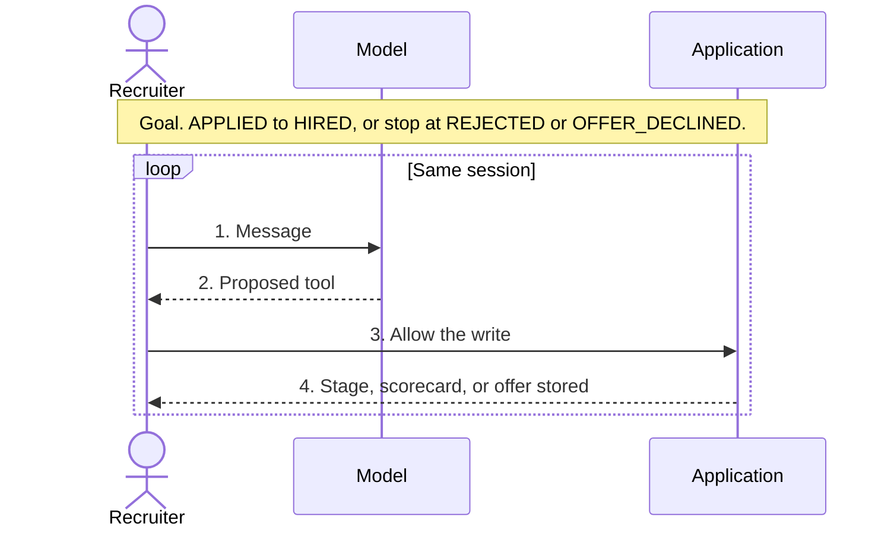
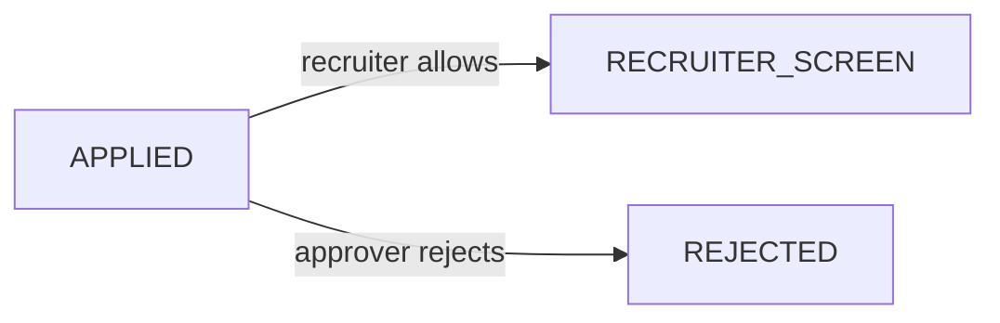
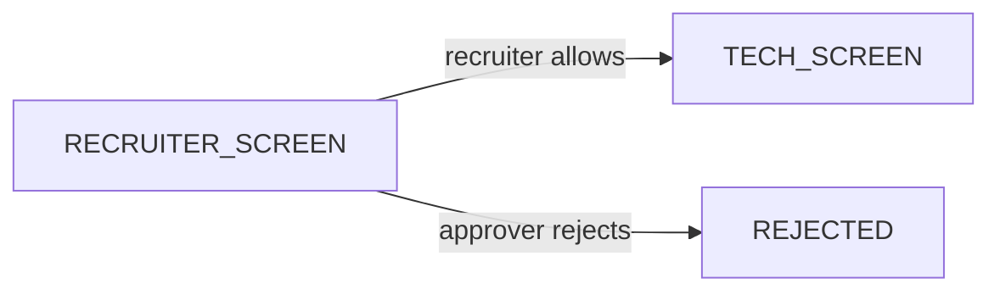
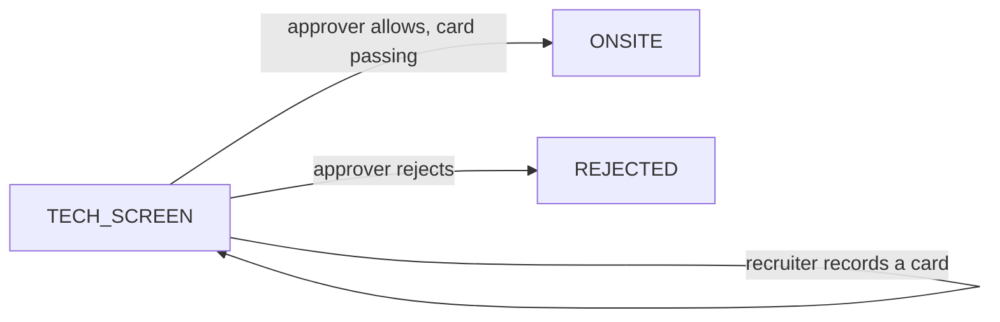
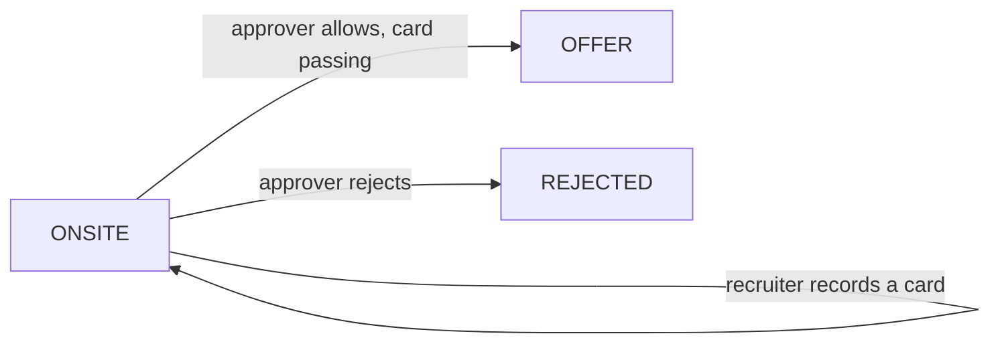
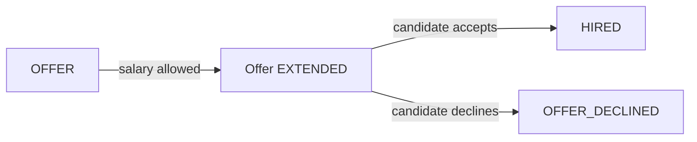

# Hiring process in this POC

## Goal

Walk one application from `APPLIED` to `HIRED`, or stop at `REJECTED` or `OFFER_DECLINED`. The model proposes the next hiring action. A person allows a write before the stage, the scorecard, or the offer changes. The same session keeps the conversation, so the next message continues that application.

## The loop

One session. Four steps. Repeat until the application is `HIRED`, `REJECTED`, or `OFFER_DECLINED`.



A read, such as `status of APP-1`, stops at step 2 and answers immediately. A deny, or a hiring rule that fails, stops before step 4. In both cases the stage stays where it was, and the recruiter sends the next message. While an approval is still `PENDING`, that next message is refused. The request, the response, and the log or trace for each of those steps are in [turn.md](turn.md). The same four steps with the session log and the application GET are in [sequences.md](sequences.md).

## Each stage

The loop above is the same at every stage. What changes is the one write that stage accepts. A skipped stage is `ILLEGAL_TRANSITION`. `APP-1` starts at `RECRUITER_SCREEN`. `APP-2` starts at `APPLIED`.

### APPLIED



### RECRUITER_SCREEN

No scorecard yet. The next stage is the tech screen.



### TECH_SCREEN

Record the tech-screen card first. The stage stays here. `YES` or `STRONG_YES` unlocks onsite. `NO` or `STRONG_NO` stays on the application and blocks onsite. It does not reject by itself.



### ONSITE

Same shape as the tech screen. The onsite card is the gate. Moving to `OFFER` is a separate allow, and only an approver can ask for it.



### OFFER

The stage stays `OFFER` when the salary is stored. Below the band fails and writes no offer. Inside the band, the recruiter allows it. Above the band, only an approver allows it. One offer per application. After the offer exists, reject is refused. Record the candidate's answer instead.



### HIRED, OFFER_DECLINED, REJECTED

The loop stops. Another advance, scorecard, offer, or reject returns `TERMINAL_STAGE`.

`OFFER_EXTENDED` is the status of the offer row, not a stage. The funnel does not skip stages.

```text
APPLIED → RECRUITER_SCREEN → TECH_SCREEN → ONSITE → OFFER → HIRED
```

## Scorecard

One round is recorded at a time, and the round name must match the current stage (`TECH_SCREEN` or `ONSITE`). The recommendation is one of `STRONG_NO`, `NO`, `YES`, `STRONG_YES`. The stub maps that word onto the four dimensions with scores 1, 2, 3, or 4. The agent does not invent a recommendation.

`YES` and `STRONG_YES` are passing. A `NO` does not reject the application. It blocks the next gated move: onsite requires a passing tech-screen card, and offer requires a passing onsite card.

## Who confirms what

| Action | Who may ask | Risk | Who may allow |
| --- | --- | --- | --- |
| Read status or history | Anyone in the tenant | Low, no pause | — |
| Recruiter screen, tech screen, scorecard, in-band offer, offer response | Recruiter or approver | Medium | The session owner |
| Onsite, offer stage, reject, above-band salary | Approver | High | Approver |
| Salary below the band | Recruiter | Medium | Owner, then the tool returns `OFFER_OUT_OF_BAND` |

Reject reasons are `BAR_NOT_MET`, `ROLE_MISMATCH`, and `CANDIDATE_WITHDREW`. Reject is refused once an offer exists or the application is already terminal. Record the offer response instead.

## Phrases the stub understands

| You say | Tool |
| --- | --- |
| `status of APP-1` | `getApplication` |
| `history for APP-1` | `listHiringActions` |
| `schedule tech screen for APP-1` | advance to `TECH_SCREEN` |
| `move APP-1 to recruiter screen` | advance to `RECRUITER_SCREEN` |
| `advance APP-1 to onsite` | advance to `ONSITE` |
| `advance APP-1 to offer` | advance to `OFFER` |
| `tech screen for APP-1 was yes` | scorecard, round follows the words `tech screen` or `onsite` |
| `onsite for APP-1 was strong yes` | scorecard |
| `extend offer for APP-1 L4 150000` | `extendOffer` |
| `candidate accepted offer for APP-1` | response `ACCEPTED` |
| `candidate declined offer for APP-1` | response `DECLINED` |
| `reject APP-1 bar not met` | `rejectApplication` |
| `note: ...` | no tool; used to fill the compaction window |

The automated tests and `scripts/walkthrough.py` use these phrases with the stub. The Postman collection does not. Each message there names the tool (`Call advanceApplication`, `Call recordScorecard`, and so on) so `openai/gpt-4o-mini` on OpenRouter invokes it. That run needs `SPRING_PROFILES_ACTIVE=openrouter` and `OPENROUTER_API_KEY`.

## Left out on purpose

Calendars, resume parsing, live interviews, a multi-person debrief loop, calibration, candidate email, offer letters, expiry, negotiation, equity, background checks, and any connection to the jobs-posting product.
