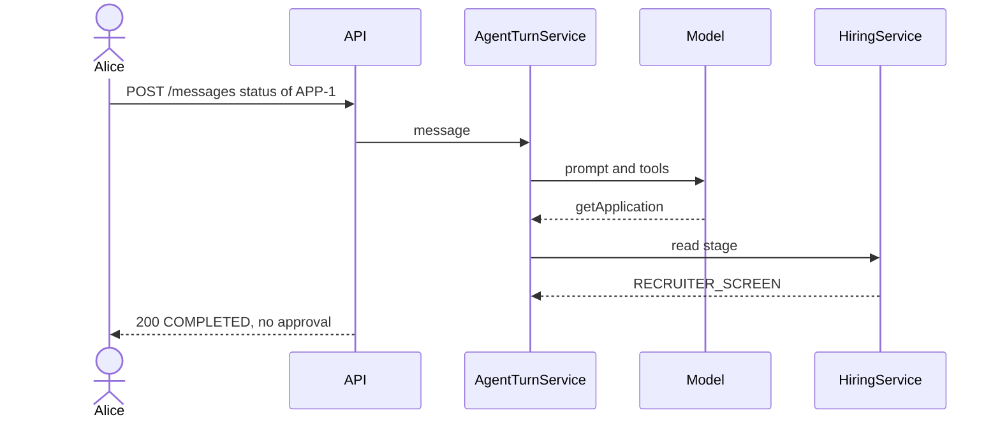
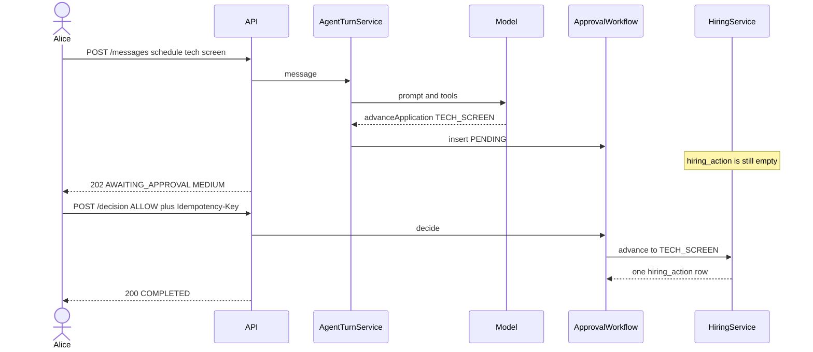
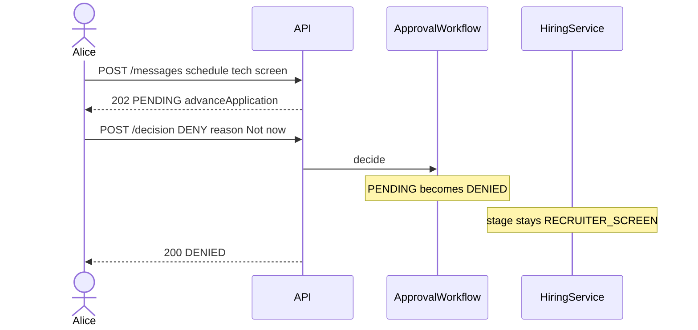
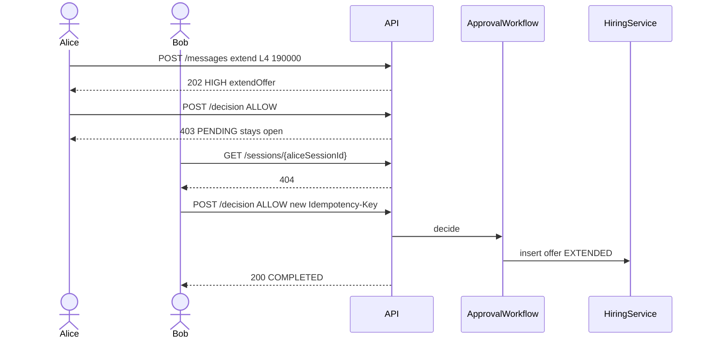
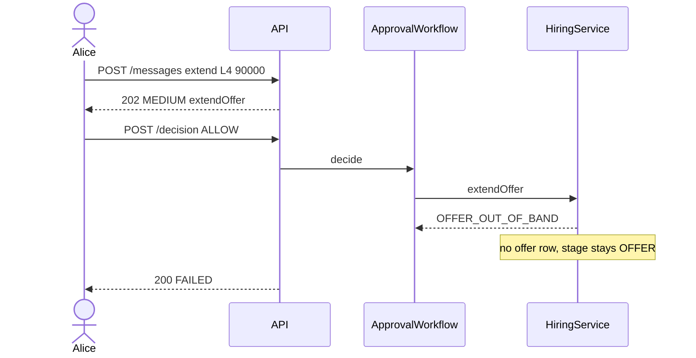
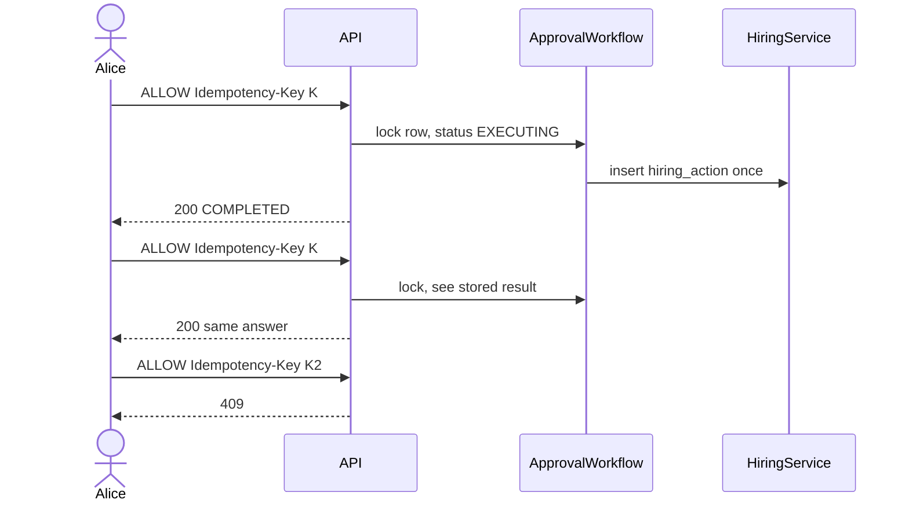
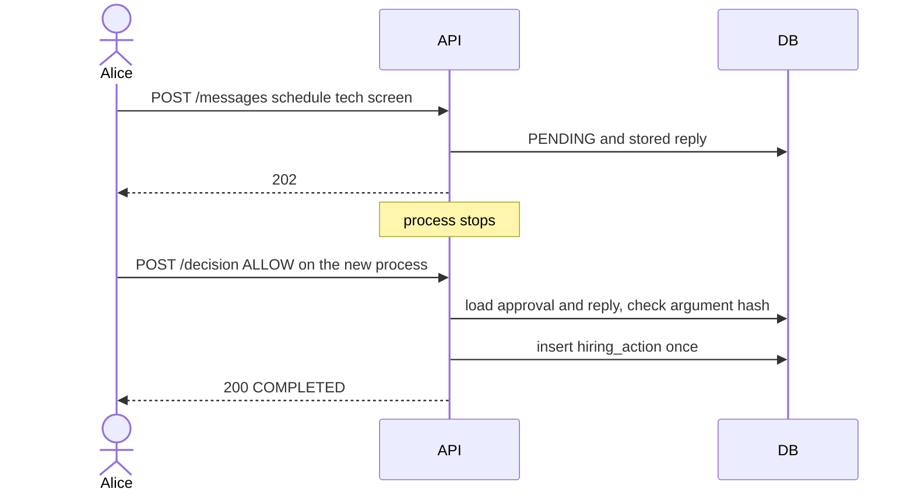
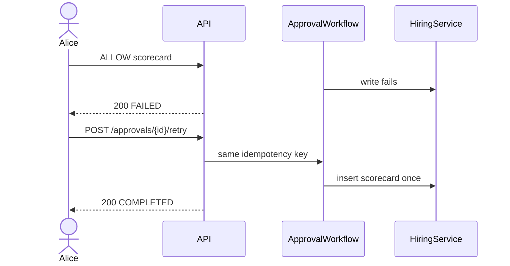
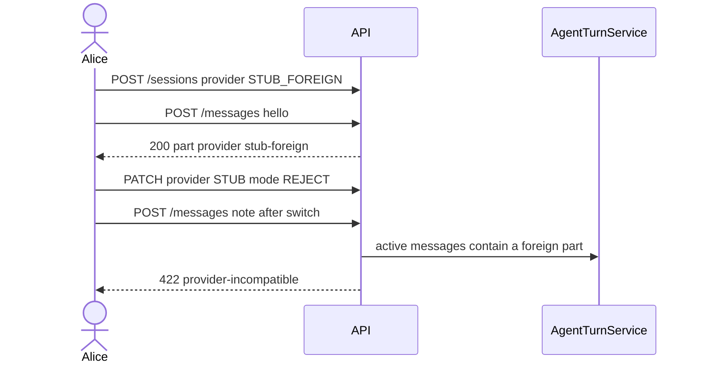

# Sequences

`postman/Stateful-hiring-agent.postman_collection.json` runs the first five diagrams in order on a fresh `APP-1`. The stub phrases in `http/scenarios.http` and `scripts/walkthrough.py` follow the same funnel.

## Read the stage

A status question does not open an approval and does not write a hiring action.

## Schedule, then allow

The model asks to move the stage. The turn stores `PENDING` and returns `202`. The stage changes only after Alice allows the call.

Bob uses the same pause on his own session for `ONSITE` and `OFFER`. Those calls are `HIGH` because he is the approver. Acceptance then sets the offer to `ACCEPTED` and the stage to `HIRED`.

## Deny

A deny closes the pause and leaves the application where it was. The collection denies the first schedule, then sends a second one.

## Above the band

`190000` is above `APP-1`'s band, so the pause is `HIGH`. Alice can see the approval and still cannot allow it. Bob allows it without being able to read her session.

Carol and Dave also receive `404` on Alice's session. A tenant mismatch looks like a missing session.

## Rule failure after allow

The pause is created before the band or the scorecard is checked. Allow runs the tool, and the hiring rule ends the approval as `FAILED`.

An onsite `NO` uses the same shape. Bob allows the advance to `OFFER`, `HiringService` returns `SCORECARD_NOT_PASSING`, and the stage stays `ONSITE`. A later `STRONG_YES` is the card the gate uses, so the next advance completes.

## Same decision twice

The first key writes the action. The same key returns that result. A different key after the row is decided returns `409`.

## Restart while pending

The pause is the approval row and the stored assistant message. A new process loads both and runs the tool once.

`RestartWhilePendingScenarioTest` closes the first Spring context and approves from a second one on the same database.

## Not on the collection run

### Retry after a forced failure

`FailureGate` fails the next scorecard write and records `FAILED`. Retry uses the same idempotency key, so the second attempt inserts the scorecard once.

### Provider switch

A `STUB_FOREIGN` turn stores an opaque part. Patching the session to `STUB` with `REJECT` makes the next message `422`. `STRIP_PROVIDER_PAYLOAD` rewrites that part to text before the stub sees the prompt. The event log still has the original part.

### Compaction

With the test limit of 3 turns, the fourth `note:` message stores a compaction event. `view=all` keeps the full log. `view=active` is the window the model sees. Compose keeps 20 turns, so four notes do not compact there.
