# Sequences

The HTTP body, the log line, and the trace for one turn are in [turn.md](turn.md). This page is how the three records stay linked while that turn runs.

Three records move together. They are not the same table.

| Record | Table | What a turn does to it |
| --- | --- | --- |
| Session | `agent_session` and `AI_SESSION` | One chat. Same id in both tables. The application row stores the provider, because Spring AI session metadata cannot be updated. |
| Conversation | `AI_SESSION_EVENT` and `tool_approval` | Every message is appended to the event log. A write tool also inserts a `PENDING` approval whose `paused_reply_event_id` is that assistant event. |
| Application | `job_application`, `hiring_action`, `interview_scorecard`, `job_offer` | Unchanged until someone allows the paused tool. The tool names `APP-1` in its arguments. The application is not a child of the session. |

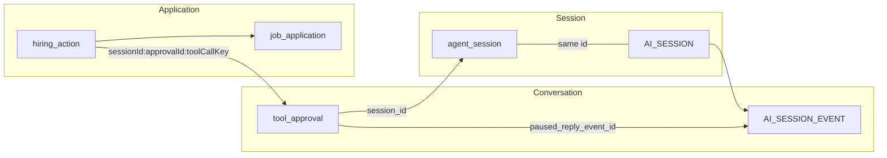

The first diagram is one turn from opening the session through an allowed stage change. The diagram after it is `ApplicationController`: the GET that reads the same application without a session and without the model. The later diagrams are the same turn in the cases the Postman collection runs: deny, a salary above the band, a rule failure, and a replayed decision.

## One turn, three records

Alice opens her session, asks for the stage, asks to schedule the tech screen, then allows it. `APP-1` stays at `RECRUITER_SCREEN` until the allow.

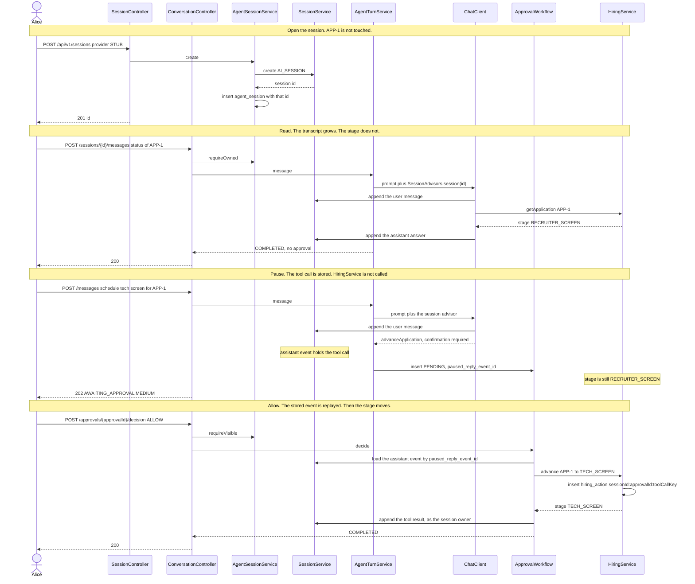

`POST /messages` is owner-only, so it uses `requireOwned`. A decision uses `requireVisible`: the owner, or a same-tenant approver. Bob can allow Alice's high-risk approval and still gets 404 if he reads her transcript, because `GuardingSessionDecorator` hides `AI_SESSION_EVENT` from anyone who is not the owner. The follow-up model call after an allow runs as the system so that append still lands on Alice's log.

A new message while `tool_approval` is `PENDING` returns 409. The transcript is not given a second turn until that approval is decided.

## The application GET

`ApplicationController` is a second door onto `job_application`. It does not create a session, does not append a message, and does not allow a tool. The lab page and Postman use it to check what the allow actually stored.

There are two reads of the same row:

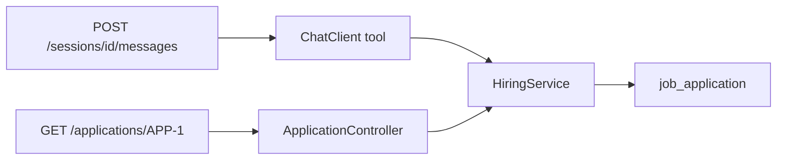

The chat read happens inside the turn above (`getApplication`). This one is the check after the turn:

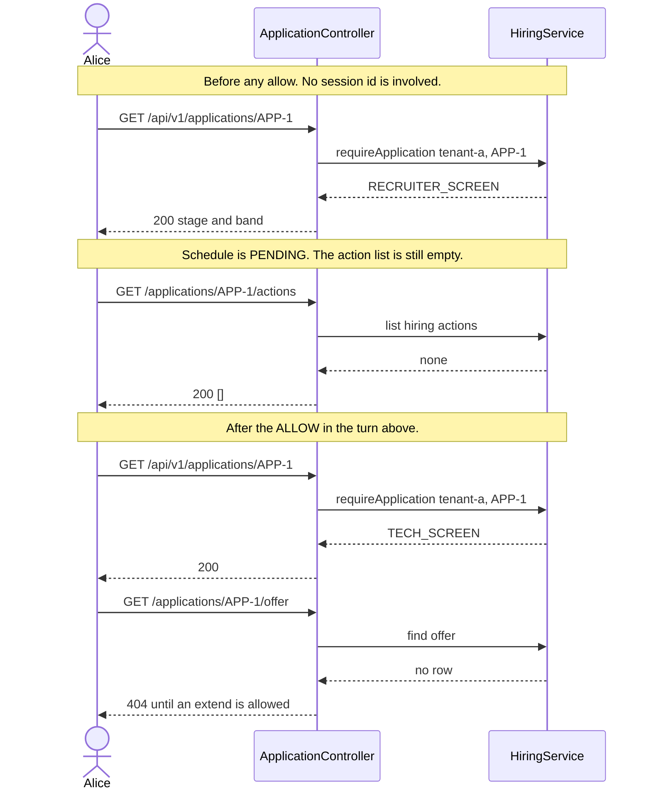

Carol calling the same `GET /applications/APP-1` receives 404. The row belongs to tenant-a. The controller never writes the stage. A write still has to come from an allowed tool in the conversation.

## Read the stage

This is the chat path already drawn in the full turn. A status question does not open an approval and does not write a hiring action. The GET in the section above is how you confirm the same stage without asking the model.

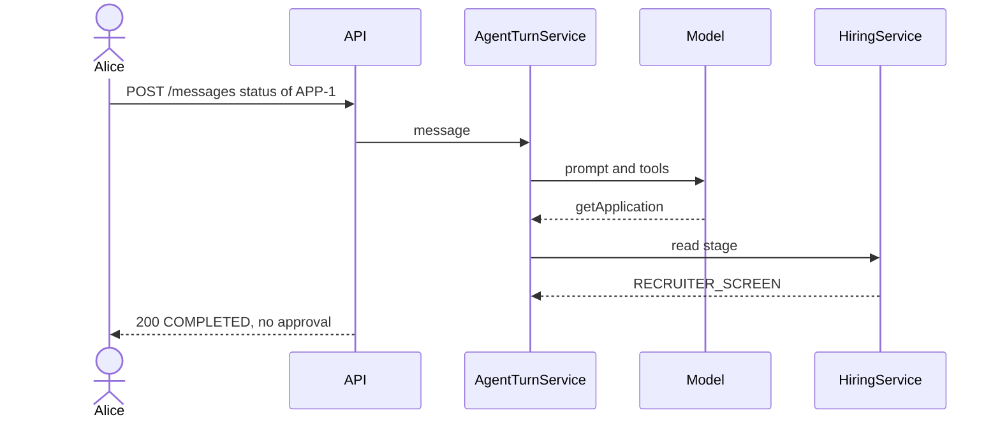

## Schedule, then allow

The model asks to move the stage. The turn stores `PENDING` and returns `202`. The stage changes only after Alice allows the call.

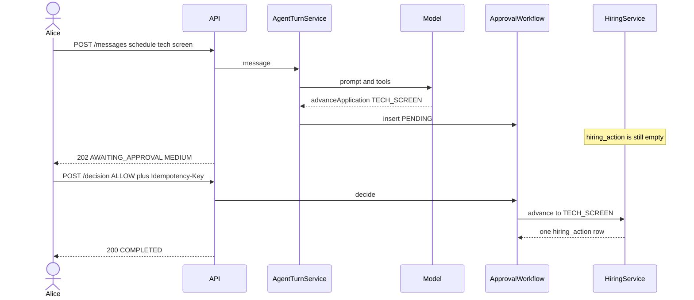

Bob uses the same pause on his own session for `ONSITE` and `OFFER`. Those calls are `HIGH` because he is the approver. Acceptance then sets the offer to `ACCEPTED` and the stage to `HIRED`.

## Deny

A deny closes the pause and leaves the application where it was. The collection denies the first schedule, then sends a second one.

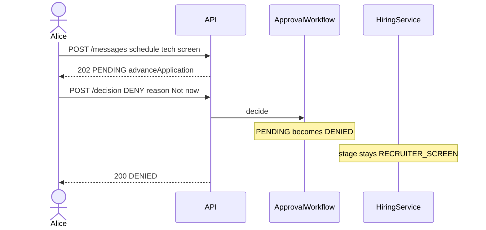

## Above the band

`190000` is above `APP-1`'s band, so the pause is `HIGH`. Alice can see the approval and still cannot allow it. Bob allows it without being able to read her session.

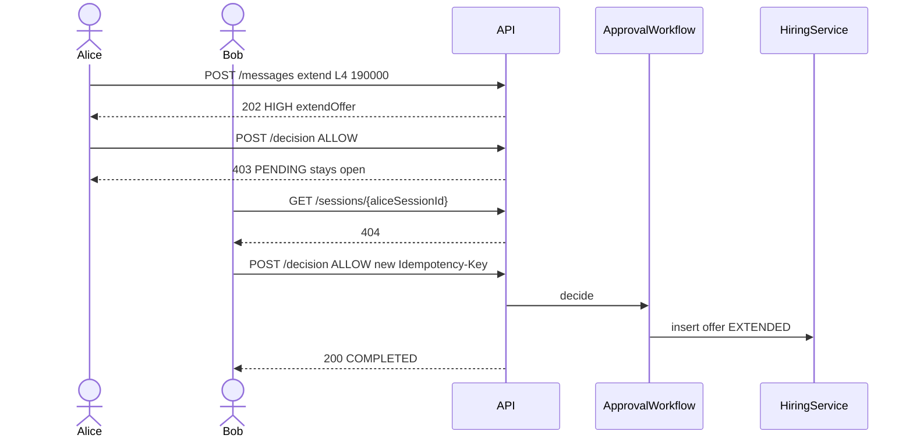

Carol and Dave also receive `404` on Alice's session. A tenant mismatch looks like a missing session.

## Rule failure after allow

The pause is created before the band or the scorecard is checked. Allow runs the tool, and the hiring rule ends the approval as `FAILED`.

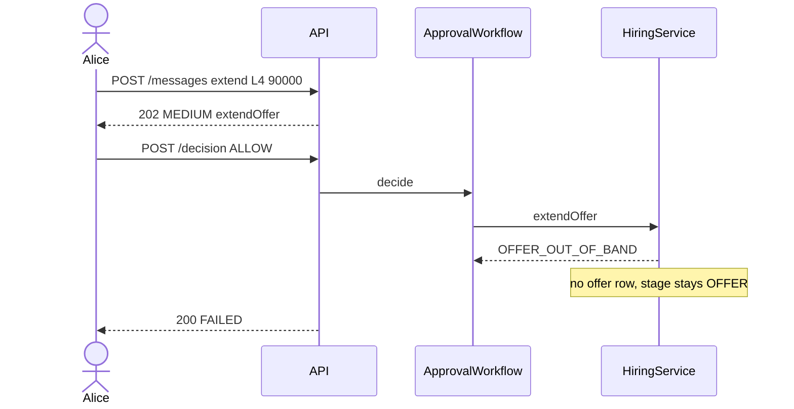

An onsite `NO` uses the same shape. Bob allows the advance to `OFFER`, `HiringService` returns `SCORECARD_NOT_PASSING`, and the stage stays `ONSITE`. A later `STRONG_YES` is the card the gate uses, so the next advance completes.

## Same decision twice

The first key writes the action. The same key returns that result. A different key after the row is decided returns `409`.

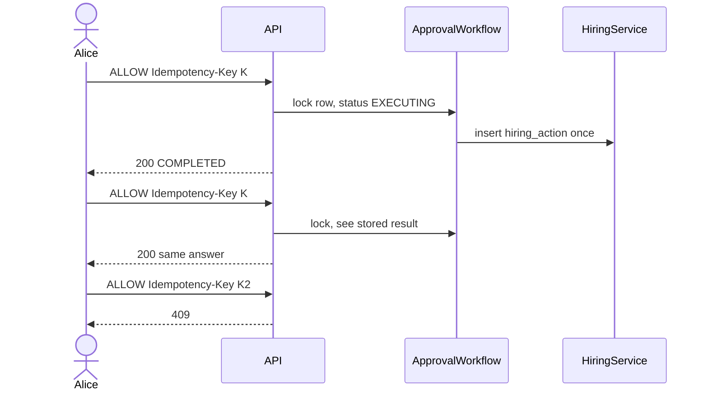

## Restart while pending

The pause is the approval row and the stored assistant message. A new process loads both and runs the tool once.

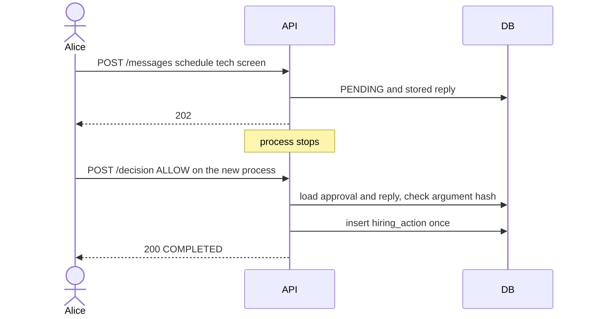

`RestartWhilePendingScenarioTest` closes the first Spring context and approves from a second one on the same database.

## Not on the collection run

### Retry after a forced failure

`FailureGate` fails the next scorecard write and records `FAILED`. Retry uses the same idempotency key, so the second attempt inserts the scorecard once.

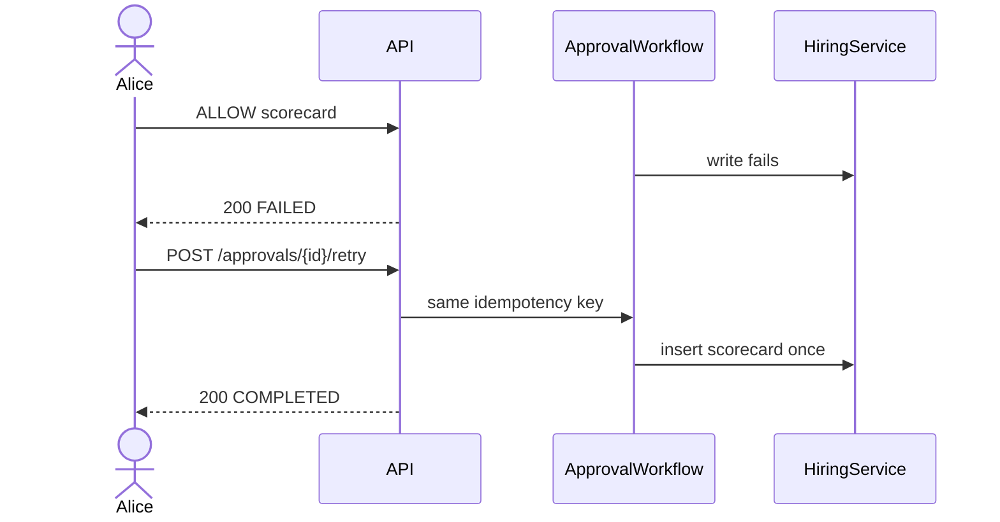

### Provider switch

A `STUB_FOREIGN` turn stores an opaque part. Patching the session to `STUB` with `REJECT` makes the next message `422`. `STRIP_PROVIDER_PAYLOAD` rewrites that part to text before the stub sees the prompt. The event log still has the original part.

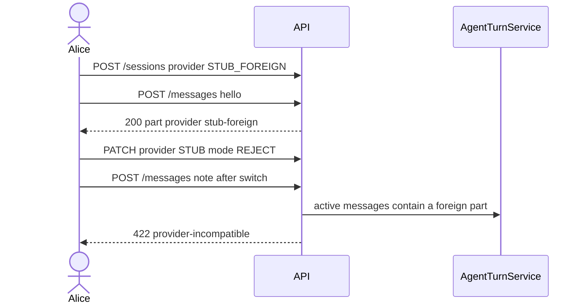

### Compaction

With the test limit of 3 turns, the fourth `note:` message stores a compaction event. `view=all` keeps the full log. `view=active` is the window the model sees. Compose keeps 20 turns, so four notes do not compact there.
