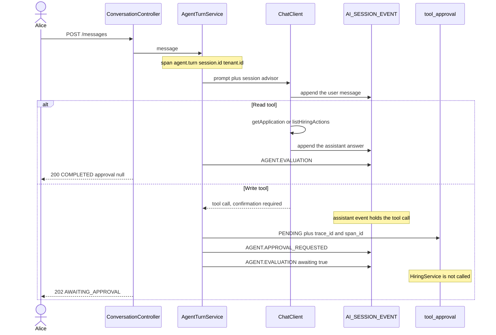
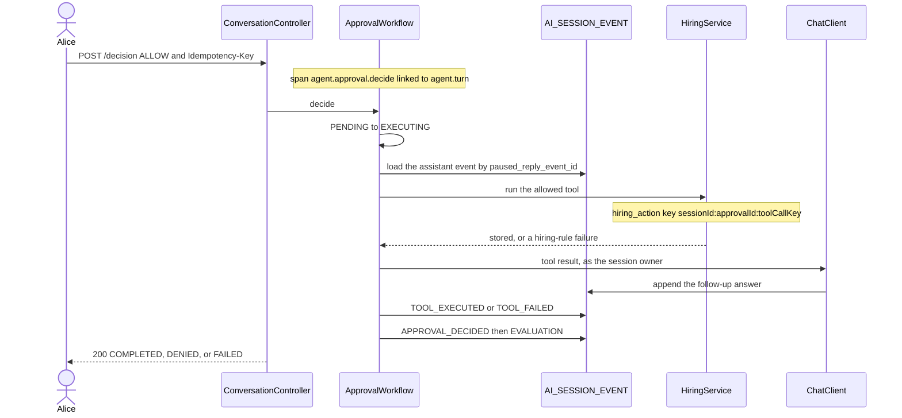
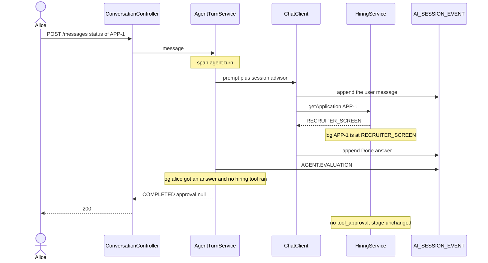
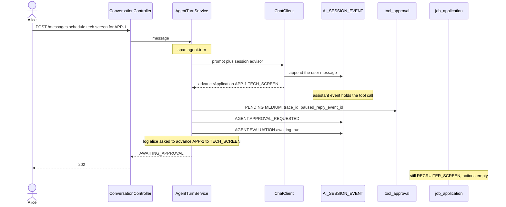
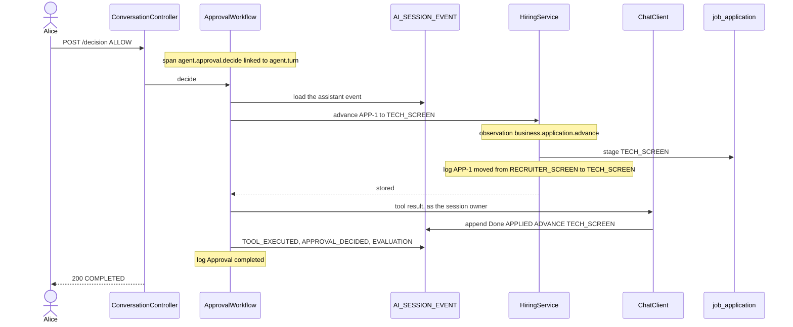
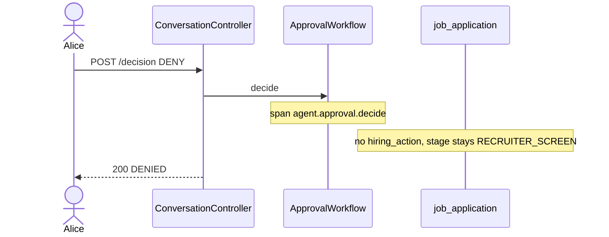
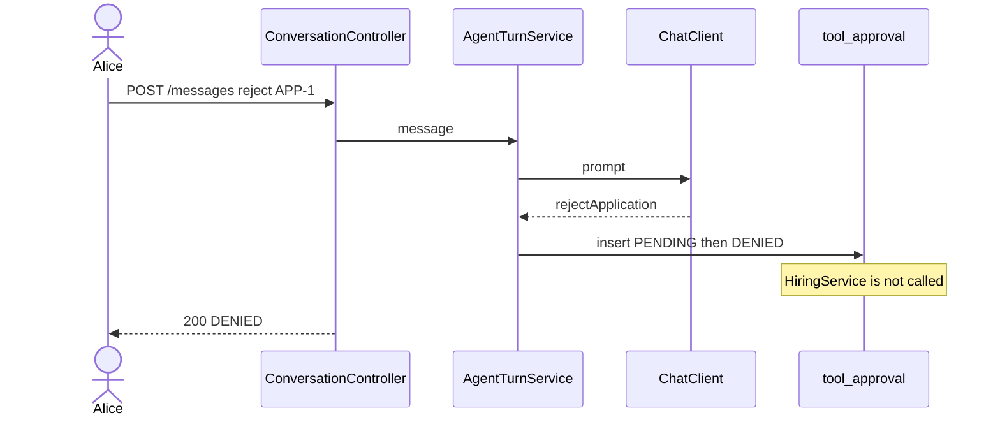
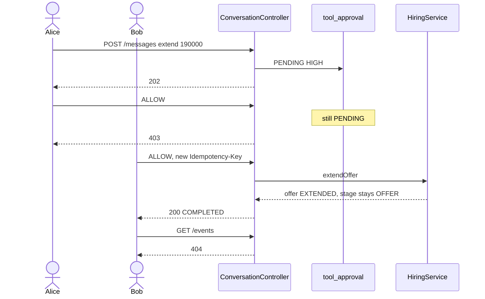
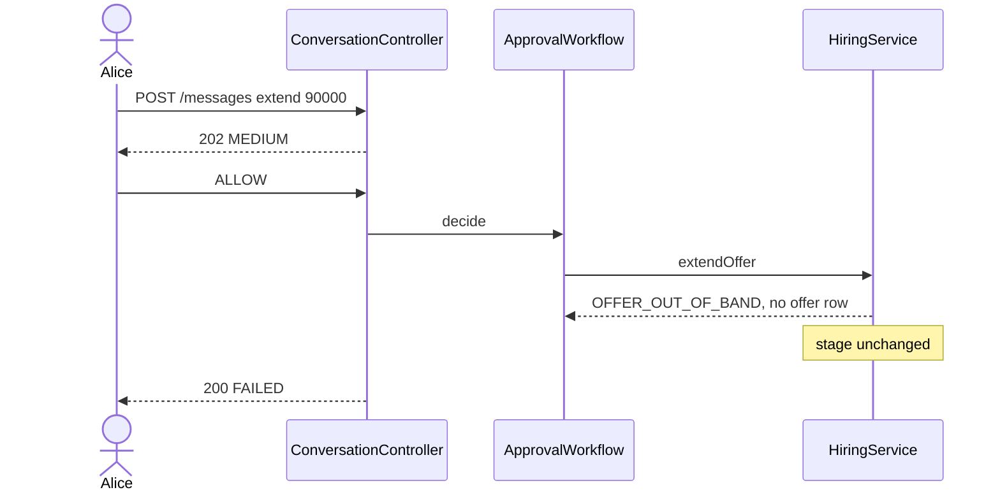

# One turn

A turn is one call that talks to the model, or the later call that finishes a paused write. Opening a session is not a turn. `GET /api/v1/applications/APP-1` is not a turn. Those two never change the stage.

The same session holds every turn. The next message sees the earlier ones. A write is two turns: the message that pauses, then the decision that stores the change.

## What you send

Both calls use HTTP Basic. `{id}` is the `id` from `POST /api/v1/sessions`. The message text is required and at most 4000 characters.

| Call | Who | Body |
| --- | --- | --- |
| `POST /api/v1/sessions/{id}/messages` | Owner only. Bob posting on Alice's session is 404. | `{ "text": "schedule tech screen for APP-1" }` |
| `POST /api/v1/sessions/{id}/approvals/{approvalId}/decision` | Owner, or a same-tenant approver. | Header `Idempotency-Key`. Body `{ "decisions": [ { "toolCallKey": "...", "decision": "ALLOW", "reason": null } ] }` |

`approvalId` is `approval.id` from the 202. `toolCallKey` is `approval.calls[0].toolCallKey` from that same body. Send one decision per call. `reason` is stored when the decision is `DENY`.

## What you get back

A turn that the agent accepts always has this shape:

```json
{
  "status": "AWAITING_APPROVAL",
  "answer": null,
  "approval": {
    "id": "…",
    "status": "PENDING",
    "risk": "MEDIUM",
    "calls": [
      { "toolCallKey": "…", "toolName": "advanceApplication", "decision": "PENDING" }
    ]
  }
}
```

`answer` is the model text. It is null while the turn is waiting. On the stub, a finished read or a finished allow starts with `Done: `. A live model uses the same `status` and writes different prose.

`approval` is present only when a write tool was proposed. It stays on the body after the decision, with `status` moved to `COMPLETED`, `DENIED`, or `FAILED`. A plain read sets `approval` to null.

| `status` | HTTP | `APP-1` |
| --- | --- | --- |
| `COMPLETED`, `approval` null | 200 | Unchanged. A read, or a reply with no tool. |
| `AWAITING_APPROVAL` | 202 | Unchanged. `tool_approval` is `PENDING`. |
| `DENIED` | 200 | Unchanged. A person denied it, or the caller may not invoke that tool. |
| `FAILED` | 200 | Unchanged. The tool ran and a hiring rule rejected it. The code is in `answer`, for example `OFFER_OUT_OF_BAND: The salary is below the role band.` |
| `COMPLETED`, with an approval | 200 | The stage, the scorecard, or the offer was stored. |

Some calls never become a turn. They return a problem body (`type`, `title`, `status`, `detail`), not the shape above.

| HTTP | `type` ends with | When | What stays |
| --- | --- | --- | --- |
| 409 | `conflict` | Another message while an approval is `PENDING`, or a second decision with a different `Idempotency-Key`. | The first decision. |
| 403 | `forbidden` | The owner allows a high-risk write. | `PENDING`. An approver can still allow it. |
| 404 | `not-found` | Another tenant, a non-owner reading the transcript, or `GET .../offer` before an offer exists. | Unchanged. |
| 422 | `provider-incompatible` | The next model cannot replay a foreign message part and the session mode is `REJECT`. The body also has `issues`. | Unchanged. |
| 400 | `invalid-request` | Blank text, a missing `Idempotency-Key`, or a malformed id. | Unchanged. |

The same `Idempotency-Key` on an approval that is already decided returns the stored turn again. The tool does not run a second time.

## Inside the message

`POST /messages` starts span `agent.turn`. A second message while an approval is `PENDING` returns 409 before this diagram. A foreign message part in `REJECT` mode returns 422 before the model is called.

A read runs the tool and returns 200. A write stops before `HiringService`. The assistant message is already in the log. The approval stores `trace_id`, `span_id`, and `paused_reply_event_id`.



If Alice may not invoke that tool, the same path inserts the approval and then marks it `DENIED`. The response is 200, not 202. That diagram is under "Alice asks to reject".

## Inside the decision

`POST .../decision` starts span `agent.approval.decide` and links it to the `agent.turn` span stored on the approval. A different session id is 404. High risk without an approver is 403 and the row stays `PENDING`. The same `Idempotency-Key` returns the stored body and skips the tool. A different key is 409.



A deny stops before `HiringService`. A rule failure still calls it, writes no stage change, and returns `FAILED`. Both are drawn below.

## Three calls on one session

Alice owns the session. `APP-1` starts at `RECRUITER_SCREEN`, role Backend Engineer, band 120000 to 160000. The stub is the model. A live model uses the same statuses. The answer text will differ.

### 1. Read



```http
POST /api/v1/sessions/{id}/messages
Authorization: Basic alice

{ "text": "status of APP-1" }
```

```json
{
  "status": "COMPLETED",
  "answer": "Done: {\"applicationId\":\"APP-1\",\"roleTitle\":\"Backend Engineer\",\"stage\":\"RECRUITER_SCREEN\"}",
  "approval": null
}
```

| Surface | What you see |
| --- | --- |
| Log | `APP-1 is at RECRUITER_SCREEN.` then `alice got an answer and no hiring tool ran.` |
| Span | `agent.turn` only. No `agent.approval.decide`. |
| `tool_approval` | No row. |
| `AI_SESSION_EVENT` | The user text, the assistant answer, and `AGENT.EVALUATION`. |
| `GET /api/v1/applications/APP-1` | `stage` `RECRUITER_SCREEN`, `bandMin` `120000.00`, `bandMax` `160000.00`. |
| `GET .../evaluation` | `passed` `true`. Checks `view=ok,actions=ok,hired=ok,gates=ok`. |

### 2. Pause



```http
POST /api/v1/sessions/{id}/messages

{ "text": "schedule tech screen for APP-1" }
```

```json
{
  "status": "AWAITING_APPROVAL",
  "answer": null,
  "approval": {
    "id": "…",
    "status": "PENDING",
    "risk": "MEDIUM",
    "calls": [
      { "toolCallKey": "…", "toolName": "advanceApplication", "decision": "PENDING" }
    ]
  }
}
```

The proposed arguments are `applicationId=APP-1` and `stage=TECH_SCREEN`. Risk is medium because the tech screen is not in the high-risk stages (`ONSITE`, `OFFER`). Alice can allow it herself.

| Surface | What you see |
| --- | --- |
| Log | `alice asked to advance APP-1 to TECH_SCREEN. This is medium risk, so a recruiter can allow it. Waiting on approval {id}.` |
| Span | `agent.turn`. Its trace id and span id are copied onto `tool_approval`. They are not in the HTTP body. |
| `tool_approval` | `PENDING`, `requested_by` `alice`, `paused_reply_event_id` set, `risk_level` `MEDIUM`. |
| `tool_call_decision` | `advanceApplication`, decision `PENDING`, arguments JSON, and the SHA-256 of those arguments. |
| `AI_SESSION_EVENT` | The user text, the assistant message that holds the tool call, `AGENT.APPROVAL_REQUESTED`, and `AGENT.EVALUATION` with `awaiting` `true`. |
| `GET /api/v1/applications/APP-1` | Still `RECRUITER_SCREEN`. |
| `GET .../actions` | `[]`. |
| `GET .../approvals?status=PENDING` | The approval above. Alice and Bob can both list it. Carol gets 404. |

A new message now returns 409. Decide this approval first.

### 3. Allow



```http
POST /api/v1/sessions/{id}/approvals/{approval.id}/decision
Idempotency-Key: 7c1e…

{ "decisions": [ { "toolCallKey": "{calls[0].toolCallKey}", "decision": "ALLOW" } ] }
```

```json
{
  "status": "COMPLETED",
  "answer": "Done: {\"status\":\"APPLIED\",\"action\":\"ADVANCE\",\"stage\":\"TECH_SCREEN\"}",
  "approval": { "id": "…", "status": "COMPLETED", "risk": "MEDIUM", "calls": [ { "toolCallKey": "…", "toolName": "advanceApplication", "decision": "ALLOW" } ] }
}
```

| Surface | What you see |
| --- | --- |
| Log | `alice allowed advance APP-1 to TECH_SCREEN on approval {id}. This is medium risk, so a recruiter can allow it.` then `APP-1 moved from RECRUITER_SCREEN to TECH_SCREEN.` then `Approval {id} completed.` |
| Spans | `agent.approval.decide` linked to the pause. Inside it, observation `business.application.advance` with `hiring.action` `ADVANCE`, `tenant.id` `tenant-a`, `application.id` `APP-1`. |
| `hiring_action` | One row. The key is `{sessionId}:{approvalId}:{toolCallKey}`. `from_stage` `RECRUITER_SCREEN`, `to_stage` `TECH_SCREEN`. `status` `APPLIED` inside the answer means this row was inserted. It is not the funnel stage. `REPLAYED` means the same key was already stored. |
| `job_application` | `stage` `TECH_SCREEN`. |
| `AI_SESSION_EVENT` | The tool result, the follow-up assistant text, `AGENT.TOOL_EXECUTED`, `AGENT.APPROVAL_DECIDED`, and a new `AGENT.EVALUATION`. |
| `GET /api/v1/applications/APP-1` | `stage` `TECH_SCREEN`. |
| `GET .../actions` | The advance row. |
| `GET .../approvals?status=PENDING` | `[]`. |

Posting the same `Idempotency-Key` again returns this body and does not insert a second action. The log says the approval is already `COMPLETED` and the same key returned that result.

## Deny, a blocked tool, a high-risk allow, a rule failure

Same session. Only the input changes.

### Deny

`"decision": "DENY"` and a `reason`. The log says `alice denied advance APP-1 to TECH_SCREEN on approval {id}. Nothing was written.`



### Alice asks to reject

She cannot invoke `rejectApplication`. The message itself returns 200 `DENIED`. The log says `alice is not allowed to reject APP-1 (BAR_NOT_MET). Denied without asking anyone to approve.` There is no 202 and no 403. Bob has to send the reject on his own session.



### Salary above the band

`extend offer for APP-1 L5 190000` returns 202 with `risk` `HIGH`. Alice's `ALLOW` returns 403. The log says `alice cannot allow this. High-risk actions need an approver.` Bob posts `ALLOW` on Alice's session with his own `Idempotency-Key` and gets 200 `COMPLETED`. He still gets 404 on `GET .../events`.



### Salary below the band

`extend offer for APP-1 L4 90000` is medium risk, so Alice's `ALLOW` is accepted. The tool then fails. The answer contains `OFFER_OUT_OF_BAND`. The log says `APP-1: The salary is below the role band.` and `Approval {id} did not change the application.` `GET .../offer` stays 404.



## Where each fact shows up

| Question | Where |
| --- | --- |
| What did Alice say, and what did the model answer? | `GET /api/v1/sessions/{id}/events?view=all`. Each item has `id`, `type`, `text`, and `parts`. Owner only. Bob gets 404. Audit events (`AGENT.*`) have no message text. Their payload is not in this list. |
| What will the next model call see? | `GET .../events` with `view=active` (the default). Compaction drops older turns from this window when the turn count is greater than `max-turns` (20 in Compose, 3 in tests). `view=all` keeps the full log, including the summary boundary. |
| Is a write still waiting? | `GET .../approvals?status=PENDING`. Omit `status` to list every approval. The owner and a same-tenant approver can list these. |
| Did the stage, the scorecard, or the offer change? | `GET /api/v1/applications/APP-1`, then `/actions`, `/scorecards`, or `/offer`. This GET does not open a session and does not append an event. |
| Did the checks after the turn pass? | `GET .../evaluation`. A session with no evaluation event returns 404. |
| The sentence for this step | The agent log, logger `dev.mytechprofile.statefulagent` at `INFO`. It names the user and the action. It does not print the recruiter's message. |
| The pause and the allow as one trace | Grafana on port 3000 (`otel-lgtm`). Find span `agent.turn`, then `agent.approval.decide` linked from the `trace_id` and `span_id` stored on `tool_approval`. |

`GET .../evaluation` returns `passed` and `checks`. `passed` is `true` only when every check ends in `=ok`.

| Check | `=ok` means | The failure value |
| --- | --- | --- |
| `view` | Every assistant tool call is followed by a tool result, or it is the last message and an approval is still `PENDING` or `EXECUTING`. A pause is not an orphan. | `view=orphan-tool-call` |
| `actions` | Every `hiring_action` for this session points at an approval that is no longer `PENDING` or `DENIED`. | `actions=unapproved` |
| `hired` | A move to `HIRED` has an offer row in status `ACCEPTED`. | `hired=missing-acceptance` |
| `gates` | A move to `ONSITE` has a passing tech-screen card, and a move to `OFFER` has a passing onsite card. Moves to `RECRUITER_SCREEN` and `TECH_SCREEN` have no card to check. | `gates=missing-scorecard` |

The evaluation is recorded after the answer is chosen. A failed check is a warning in that event. It does not replace the HTTP body and it does not roll the stage back.

Later writes use the same two calls. The observation name changes with the tool: `business.application.scorecard`, `business.offer.extend`, `business.offer.respond`, `business.application.reject`. A scorecard and an offer extension leave the stage where it was. The stage moves on an advance, a reject, or an offer response.
